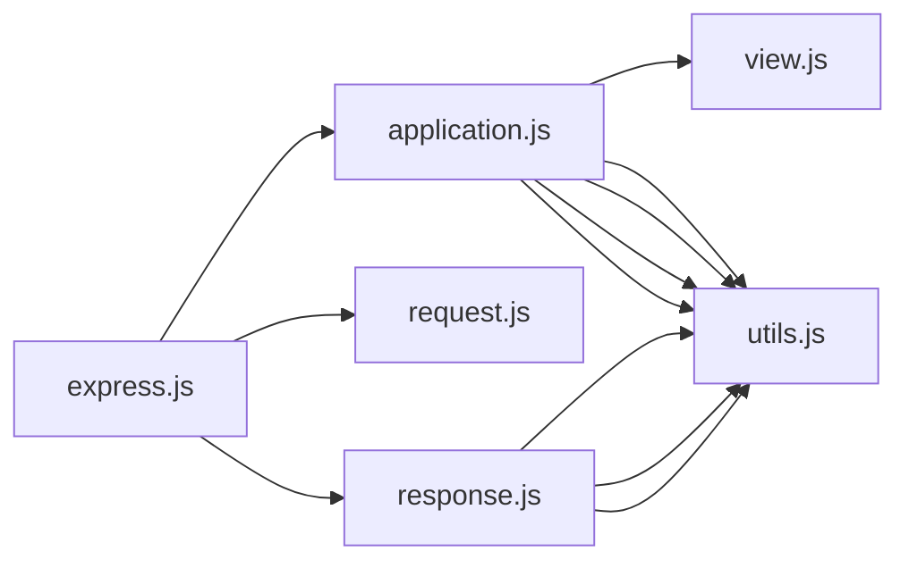

# CodeProof report

Commit: 1c6f1b0fe4000977b9a7b4f34097e4d527dd9824  |  run-id: 5eac0a79c35027de  |  mode: smoke

**Publishing rule:** a finding appears under *Verified findings* only if every citation passed L1 and the adversarial verifier confirmed it. This checks provenance and model agreement, not semantic proof. Refuted, uncertain and moderate findings are in rejected.md.

## Summary

| Metric | Value |
|---|---|
| Files / LOC | 6 / 2765 |
| Import edges / cycles | 11 / 0 |
| Findings proposed | 0 |
| Rejected at L1 (bad citation) | 0 |
| Verified | 0 |
| Reproduced by execution (L3) | 0 |
| Moderate confidence | 0 |
| Refuted | 0 |
| Uncertain | 0 |
| Calls / retries | 2 / 0 |
| Tokens in / out | 47686 / 36403 |
| Cached input tokens | 0 |
| Cost | $0.2143 |

## Verified findings

_None this run._

## Architecture

Deterministic facts only: 6 files, 2765 LOC, 11 import edges, 0 cycles. The diagram is generated from the import graph by code, never by the model.

## Limits

- Scan and verify are static: the analyzed code is never executed while the scanner and verifier run. L3 runs only the generated test, on a git-archive snapshot, inside a permission-model sandbox (no network, no writes, 2 s timeout); isolation is process-level, not OS-level.
- No completeness claim; this report shows what passed the gate, not everything that exists in the repository.
- Only direct correctness defects; omission, security and style findings are out of scope for this milestone.
- The L1 gate proves that a citation exists in the commit; the semantic match is judged by the verifier model and presented as such.

