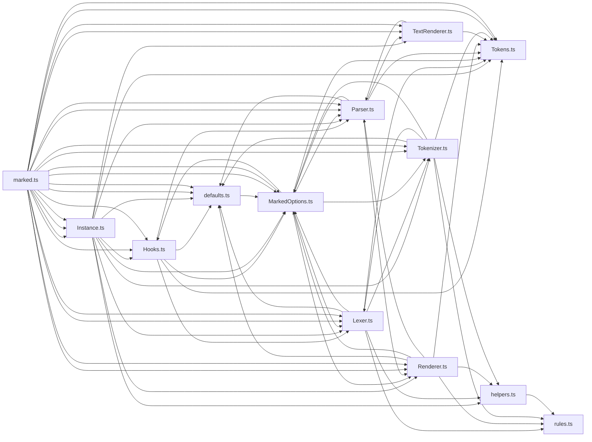

# CodeProof report

Commit: 4bdd7e0c4329ad0d6fb4b4139a25fb7aeed251ea  |  run-id: 759fa0153f434967  |  mode: smoke

**Publishing rule:** a finding appears under *Verified findings* only if every citation passed L1 and the adversarial verifier confirmed it. This checks provenance and model agreement, not semantic proof. Refuted, uncertain and moderate findings are in rejected.md.

## Summary

| Metric | Value |
|---|---|
| Files / LOC | 13 / 4070 |
| Import edges / cycles | 69 / 12 |
| Findings proposed | 3 |
| Rejected at L1 (bad citation) | 0 |
| Verified | 1 |
| Reproduced by execution (L3) | 1 |
| Moderate confidence | 0 |
| Refuted | 0 |
| Uncertain | 2 |
| Calls / retries | 8 / 0 |
| Tokens in / out | 98007 / 50546 |
| Cached input tokens | 0 |
| Cost | $1.1185 |

## Verified findings

### F-002 - high - Nested blockTokens clobbers state.top

**Claim:** Lexer.blockTokens unconditionally sets state.top=true on return, and Tokenizer.list sets state.top=false for items without saving/restoring, so a nested list clobbers the outer list-item context and subsequent tokens in the same item are lexed as top-level.

**Evidence level:** citation-proven + adversarially-confirmed + **execution-proven (generated test fails on the analyzed commit)**

**Execution check:** reproduced by execution (see Reproduced by execution)

**Citation (from commit, lines 309-310):** Lexer.ts
```text
    this.state.top = true;
    return tokens;
```
**Citation (from commit, lines 518-520):** Tokenizer.ts
```text
      for (const item of list.items) {
        this.lexer.state.top = false;
        item.tokens = this.lexer.blockTokens(item.text, []);
```

**Verifier (muse-wonder-1.0):** confirm - Lexer.ts:309-310 unconditionally sets this.state.top=true on blockTokens return, Tokenizer.ts:518-520 sets this.lexer.state.top=false before blockTokens for each list item without saving/restoring it, and Lexer.ts:273 gates paragraph lexing on this.state.top, so a nested list's return leaves the outer item lexed as top-level.

## Reproduced by execution

For each finding below, the verifier model wrote a standalone test. The test runs on a `git archive` snapshot of the analyzed commit inside a permission-model sandbox: no network, no writes, 2 s timeout, three runs. The finding is execution-proven only if the test fails 3/3 with an assertion error.

### F-002 - Nested blockTokens clobbers state.top

**Expected behavior:** After a nested list inside a non-top (list-item) context, following content in the same item is lexed as text, not a top-level paragraph.

**Generated test (fails on the analyzed commit):**
```js
import assert from 'node:assert/strict';
import { _Lexer } from './Lexer.ts';

let caught = null;
let tokens;
try {
  const lexer = new _Lexer();
  // Simulate Tokenizer.list lexing an outer list item: it sets top=false
  // before calling blockTokens for the item's contents.
  lexer.state.top = false;
  tokens = lexer.blockTokens('- inner\n\ntail', []);
} catch (err) {
  caught = err;
}

assert.equal(caught, null);
assert.ok(tokens);
assert.equal(tokens[0]?.type, 'list');
const tail = tokens.find((token) => token.text === 'tail');
assert.ok(tail, 'tail should be lexed as a separate token after the nested list');
assert.equal(tail.type, 'text');
```

**Runner output (last of 3 attempts):**
```text
- 'text'

    at file:///tmp/codeproof-repro-Jt7NIJ/snapshot/.codeproof-repro.test.mjs:21:8
    at ModuleJob.run (node:internal/modules/esm/module_job:569:25)
    at async node:internal/modules/esm/loader:650:26
    at async asyncRunEntryPointWithESMLoader (node:internal/modules/run_main:101:5) {
  generatedMessage: true,
  code: 'ERR_ASSERTION',
  actual: 'paragraph',
  expected: 'text',
  operator: 'strictEqual',
  diff: 'simple'
}

Node.js v26.8.2
```

## Architecture

Deterministic facts only: 13 files, 4070 LOC, 69 import edges, 12 cycles. The diagram is generated from the import graph by code, never by the model.



## Limits

- Scan and verify are static: the analyzed code is never executed while the scanner and verifier run. L3 runs only the generated test, on a git-archive snapshot, inside a permission-model sandbox (no network, no writes, 2 s timeout); isolation is process-level, not OS-level.
- No completeness claim; this report shows what passed the gate, not everything that exists in the repository.
- Only direct correctness defects; omission, security and style findings are out of scope for this milestone.
- The L1 gate proves that a citation exists in the commit; the semantic match is judged by the verifier model and presented as such.

