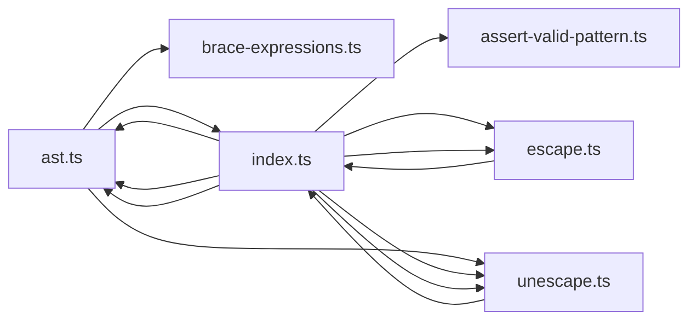

# CodeProof report

Commit: ded1bbd01beca62a5978bc1650ed0a1ccf9039d5  |  run-id: 8b8abb93cf732a74  |  mode: smoke

**Publishing rule:** a finding appears under *Verified findings* only if every citation passed L1 and the adversarial verifier confirmed it. This checks provenance and model agreement, not semantic proof. Refuted, uncertain and moderate findings are in rejected.md.

## Summary

| Metric | Value |
|---|---|
| Files / LOC | 6 / 2721 |
| Import edges / cycles | 13 / 3 |
| Findings proposed | 2 |
| Rejected at L1 (bad citation) | 0 |
| Verified | 1 |
| Reproduced by execution (L3) | 0 |
| Moderate confidence | 0 |
| Refuted | 0 |
| Uncertain | 1 |
| Calls / retries | 7 / 0 |
| Tokens in / out | 102658 / 53707 |
| Cached input tokens | 1500 |
| Cost | $0.8096 |

## Verified findings

### F-001 - high - Empty extglob misdetected when ending with |

**Claim:** Empty-extglob detection checks ast.#parts.length which is always 0 before ast.push(...parts,part), so !(a|) with trailing empty alternative is misclassified as empty !() and compiled to starNoEmpty.

**Evidence level:** citation-proven + adversarially-confirmed

**Execution check:** unavailable: the repository's own imports are not directly executable by Node without a build step (extensionless specifiers)

**Citation (from commit, lines 498-505):** ast.ts
```text
      if (c === ')') {
        if (acc === '' && ast.#parts.length === 0) {
          ast.#emptyExt = true
        }
        part.push(acc)
        acc = ''
        ast.push(...parts, part)
        return i
```

**Verifier (muse-wonder-1.0):** confirm - The check at ast.ts:499 tests ast.#parts.length before ast.push(...parts, part) at ast.ts:504, while prior alternatives are accumulated only in the local parts array at ast.ts:494, so for !(a|) acc is '' and ast.#parts is still empty, incorrectly setting ast.#emptyExt at ast.ts:500.

## Architecture

Deterministic facts only: 6 files, 2721 LOC, 13 import edges, 3 cycles. The diagram is generated from the import graph by code, never by the model.



## Limits

- Scan and verify are static: the analyzed code is never executed while the scanner and verifier run. L3 runs only the generated test, on a git-archive snapshot, inside a permission-model sandbox (no network, no writes, 2 s timeout); isolation is process-level, not OS-level.
- No completeness claim; this report shows what passed the gate, not everything that exists in the repository.
- Only direct correctness defects; omission, security and style findings are out of scope for this milestone.
- The L1 gate proves that a citation exists in the commit; the semantic match is judged by the verifier model and presented as such.

