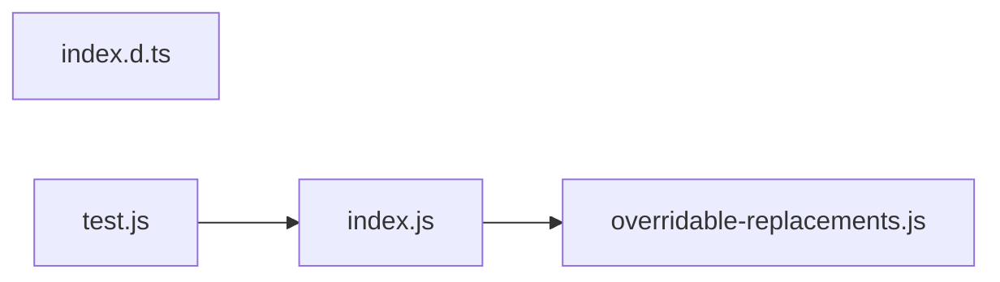

# CodeProof report

Commit: 3b17b2e84b97624a683aafaa38184bf2746fab22  |  run-id: cfae9278343d6df3  |  mode: smoke

**Publishing rule:** a finding appears under *Verified findings* only if every citation passed L1 and the adversarial verifier confirmed it. This checks provenance and model agreement, not semantic proof. Refuted, uncertain and moderate findings are in rejected.md.

## Summary

| Metric | Value |
|---|---|
| Files / LOC | 4 / 825 |
| Import edges / cycles | 2 / 0 |
| Findings proposed | 4 |
| Rejected at L1 (bad citation) | 0 |
| Verified | 4 |
| Reproduced by execution (L3) | 0 |
| Moderate confidence | 0 |
| Refuted | 0 |
| Uncertain | 0 |
| Calls / retries | 11 / 0 |
| Tokens in / out | 76646 / 64973 |
| Cached input tokens | 12597 |
| Cost | $1.0469 |

## Verified findings

### F-001 - high - Separator `$` patterns expanded in slug replacement

**Claim:** String.replace interprets `$` sequences in the replacement string, so a separator like `$&`, `$'`, `$1` or `$$` is expanded instead of inserted literally.

**Evidence level:** citation-proven + adversarially-confirmed

**Execution check:** unavailable: the repository's own imports are not directly executable by Node without a build step (extensionless specifiers)

**Citation (from commit, lines 108-108):** index.js
```text
	string = string.replace(patternSlug, options.separator);
```

**Verifier (muse-wonder-1.0):** confirm - At index.js:108 options.separator is passed directly as the string replacement argument to String.replace, so special substitution patterns such as $& , $$ and $' in the separator are expanded per JavaScript semantics instead of being inserted literally, and no function replacer or escaping guards that call.

### F-002 - high - Separator `$` patterns expanded when collapsing separators

**Claim:** removeMootSeparators passes the user separator as the replacement string to replaceAll, so `$&`/`$'`/`$$` in the separator are expanded instead of inserted literally.

**Evidence level:** citation-proven + adversarially-confirmed

**Execution check:** unavailable: the repository's own imports are not directly executable by Node without a build step (extensionless specifiers)

**Citation (from commit, lines 18-20):** index.js
```text
	return string
		.replaceAll(new RegExp(`(?:${escapedSeparator}){2,}`, 'g'), separator)
		.replaceAll(new RegExp(`^(?:${escapedSeparator})|(?:${escapedSeparator})$`, 'g'), '');
```

**Verifier (muse-wonder-1.0):** confirm - The code at index.js:19 passes the raw user separator as the string replacement to replaceAll while index.js:16 only escapes it for the RegExp pattern, so JavaScript replacement patterns such as $$, $&, and $' in the separator will be expanded rather than inserted literally.

### F-003 - medium - Unconditional backslash deletion defeats separator/preserve

**Claim:** After inserting the separator, all backslashes are unconditionally deleted, so separator `\` is erased and preserveCharacters `\` can never be preserved.

**Evidence level:** citation-proven + adversarially-confirmed

**Execution check:** unavailable: the repository's own imports are not directly executable by Node without a build step (extensionless specifiers)

**Citation (from commit, lines 108-109):** index.js
```text
	string = string.replace(patternSlug, options.separator);
	string = string.replaceAll('\\', '');
```

**Verifier (muse-wonder-1.0):** confirm - At index.js:108 the separator is inserted via replace, then index.js:109 unconditionally runs replaceAll('\\','') deleting every backslash, so a '\\' separator is erased and a backslash exempted from patternSlug by preserveCharacters handling at index.js:43-50 is likewise deleted with no later restoration.

### F-004 - medium - Custom replacement value `$` patterns expanded

**Claim:** String.replaceAll interprets `$` sequences in the replacement string, so a custom replacement value containing `$&`/`$'`/`$1`/`$$` is expanded instead of inserted literally.

**Evidence level:** citation-proven + adversarially-confirmed

**Execution check:** unavailable: the repository's own imports are not directly executable by Node without a build step (extensionless specifiers)

**Citation (from commit, lines 86-88):** index.js
```text
		for (const [key, value] of options.customReplacements) {
			string = string.replaceAll(key, value);
		}
```

**Verifier (muse-wonder-1.0):** confirm - At index.js:86-88 the user-supplied replacement value is passed directly as the string replacement argument to string.replaceAll(key, value) with no function replacer or escaping, so JavaScript substitution patterns such as $&, $', $`, and $$ in the value are expanded rather than inserted literally.

## Architecture

Deterministic facts only: 4 files, 825 LOC, 2 import edges, 0 cycles. The diagram is generated from the import graph by code, never by the model.



## Limits

- Scan and verify are static: the analyzed code is never executed while the scanner and verifier run. L3 runs only the generated test, on a git-archive snapshot, inside a permission-model sandbox (no network, no writes, 2 s timeout); isolation is process-level, not OS-level.
- No completeness claim; this report shows what passed the gate, not everything that exists in the repository.
- Only direct correctness defects; omission, security and style findings are out of scope for this milestone.
- The L1 gate proves that a citation exists in the commit; the semantic match is judged by the verifier model and presented as such.

