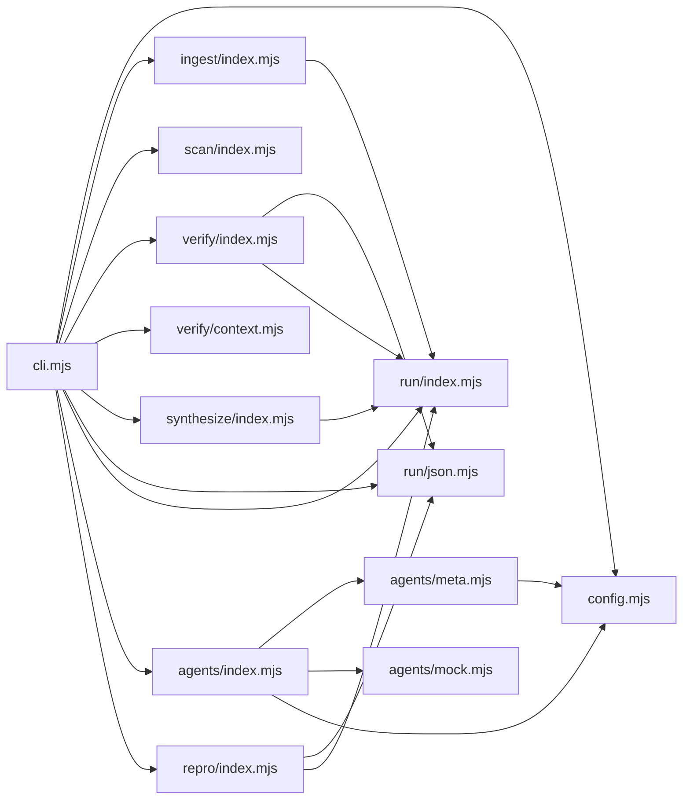

# CodeProof report

Commit: b2dbad2812b6b0a157875401b631109e6ab8d29c  |  run-id: afe3e8dd50723038  |  mode: smoke

**Publishing rule:** a finding appears under *Verified findings* only if every citation passed L1 and the adversarial verifier confirmed it. This checks provenance and model agreement, not semantic proof. Refuted, uncertain and moderate findings are in rejected.md.

## Summary

| Metric | Value |
|---|---|
| Files / LOC | 13 / 2626 |
| Import edges / cycles | 20 / 0 |
| Findings proposed | 6 |
| Rejected at L1 (bad citation) | 0 |
| Verified | 5 |
| Reproduced by execution (L3) | 4 |
| Moderate confidence | 1 |
| Refuted | 0 |
| Uncertain | 0 |
| Calls / retries | 13 / 0 |
| Tokens in / out | 109500 / 48520 |
| Cached input tokens | 10888 |
| Cost | $1.0390 |

## Verified findings

### F-001 - critical - Unknown model bypasses hard budget estimate

**Claim:** estimateCost returns 0 for unknown models, so the hard-budget gate computes a zero worst-case cost and canAfford always passes, breaking the spend cap.

**Evidence level:** citation-proven + adversarially-confirmed + **execution-proven (generated test fails on the analyzed commit)**

**Execution check:** reproduced by execution (see Reproduced by execution)

**Citation (from commit, lines 63-67):** config.mjs
```text
export function estimateCost(model, inputTokens, outputTokens) {
  const price = PRICES[model];
  if (!price) return 0;
  return ((inputTokens || 0) * price.input + (outputTokens || 0) * price.output) / 1e6;
}
```
**Citation (from commit, lines 82-85):** run/index.mjs
```text
  canAfford(estimatedCostUsd) {
    if (estimatedCostUsd === null || estimatedCostUsd === undefined) return true;
    return this.spentUsd + estimatedCostUsd <= this.limitUsd + 1e-9;
  }
```

**Verifier (muse-wonder-1.0):** confirm - Confirmed: config.mjs:65 returns 0 when PRICES[model] is missing, agents/index.mjs:28 forwards that value from estimateRequestCost, and agents/index.mjs:105-108 only rejects when budget.canAfford(estimate) fails, so an unknown env-configured model (config.mjs:19) gets a zero worst-case estimate that satisfies run/index.mjs:84 while spent remains within the limit.

### F-002 - critical - Unknown model cost never charged to budget

**Claim:** costOf returns null for unknown models and Budget.charge ignores null, so spentUsd never increases and exceeded is never set.

**Evidence level:** citation-proven + adversarially-confirmed + **execution-proven (generated test fails on the analyzed commit)**

**Execution check:** reproduced by execution (see Reproduced by execution)

**Citation (from commit, lines 69-75):** config.mjs
```text
export function costOf(model, usage) {
  const price = PRICES[model];
  if (!price) return null;
  const cached = Math.min(usage.cachedTokens || 0, usage.inputTokens || 0);
  const uncached = Math.max(0, (usage.inputTokens || 0) - cached);
  return (uncached * price.input + cached * price.cachedInput + (usage.outputTokens || 0) * price.output) / 1e6;
}
```
**Citation (from commit, lines 86-91):** run/index.mjs
```text
  charge(costUsd) {
    this.calls += 1;
    if (costUsd === null || costUsd === undefined) return;
    this.spentUsd += costUsd;
    if (this.spentUsd > this.limitUsd + 1e-9) this.exceeded = true;
  }
```

**Verifier (muse-wonder-1.0):** confirm - costOf returns null for an unpriced model at config.mjs:71, and Budget.charge returns at run/index.mjs:88 before increasing spentUsd at run/index.mjs:89 or setting exceeded at run/index.mjs:90, while agents/index.mjs:58 charges result.costUsd through that path.

### F-003 - high - Multiline imports fake reproducer usage check

**Claim:** Body stripping only removes single lines starting with import, so continuation lines of a multiline import remain and imported names falsely test as used outside imports.

**Evidence level:** citation-proven + adversarially-confirmed + **execution-proven (generated test fails on the analyzed commit)**

**Execution check:** reproduced by execution (see Reproduced by execution)

**Citation (from commit, lines 107-113):** repro/index.mjs
```text
export function extractUsedImportedSymbols(testCode) {
  const source = String(testCode || "");
  const body = source.replace(/^\s*import\b.*$/gm, "");
  return extractImportedIdentifiers(source).filter(function (name) {
    return new RegExp("\\b" + name.replace(/[.*+?^${}()|[\]\\]/g, "\\$&") + "\\b").test(body);
  });
}
```

**Verifier (muse-wonder-1.0):** confirm - The code at repro/index.mjs:109 strips only single lines via /^\s*import\b.*$/gm, while repro/index.mjs:85-92 extracts identifiers from multiline named-import blocks, so continuation-line names remain in body and satisfy the usage test at repro/index.mjs:110-111.

### F-005 - medium - Missing excerpts treated as in-context

**Claim:** When verifier excerpts are missing the function returns true, reporting a snippet as present in context instead of absent.

**Evidence level:** citation-proven + adversarially-confirmed + **execution-proven (generated test fails on the analyzed commit)**

**Execution check:** reproduced by execution (see Reproduced by execution)

**Citation (from commit, lines 134-135):** verify/index.mjs
```text
export function isSnippetInExcerpts(snippet, excerpts) {
  if (typeof excerpts !== "string") return true;
```

**Verifier (muse-wonder-1.0):** confirm - The code at verify/index.mjs:135 returns true whenever excerpts is not a string, so missing excerpts (undefined/null) are treated as containing the snippet.

### F-006 - low - Empty file counted as one line

**Claim:** Empty source splits to one element and does not end with newline, so an empty file is counted as 1 LOC instead of 0.

**Evidence level:** citation-proven + adversarially-confirmed

**Execution check:** inconclusive: reproducer failed L0: forbidden file write; forbidden ambient runtime module

**Citation (from commit, lines 175-175):** ingest/index.mjs
```text
    const lineCount = source.split("\n").length - (source.endsWith("\n") ? 1 : 0);
```

**Verifier (muse-wonder-1.0):** confirm - At ingest/index.mjs:175, ''.split('\n') has length 1 and ''.endsWith('\n') is false, so lineCount computes to 1, and the loop at ingest/index.mjs:169-176 contains no empty-source guard before assigning that loc.

## Reproduced by execution

For each finding below, the verifier model wrote a standalone test. The test runs on a `git archive` snapshot of the analyzed commit inside a permission-model sandbox: no network, no writes, 2 s timeout, three runs. The finding is execution-proven only if the test fails 3/3 with an assertion error.

### F-001 - Unknown model bypasses hard budget estimate

**Expected behavior:** estimateCost for an unknown model must not return 0 (free); it must signal unknown like costOf (null), return a positive/Infinity worst-case, or throw, so the hard-budget gate cannot always pass.

**Generated test (fails on the analyzed commit):**
```js
import assert from "node:assert/strict";
import { estimateCost, costOf } from "./config.mjs";

// Sanity: a known model has a positive worst-case estimate.
assert.ok(estimateCost("muse-spark-1.3", 1000, 1000) > 0);
// Existing contract in the same file: costOf signals unknown models with null, not $0.
assert.equal(costOf("no-such-model", { inputTokens: 1000, cachedTokens: 0, outputTokens: 1000 }), null);

let est;
let thrown = null;
try {
  est = estimateCost("no-such-model", 1000000, 1000000);
} catch (e) {
  thrown = e;
}
// Unknown model must not produce a $0 worst-case that canAfford() always passes:
// it must signal unknown (null), be positive/Infinity, or fail safe by throwing.
assert.ok(
  thrown !== null || est === null || est === Infinity || (typeof est === "number" && est > 0),
  `unknown model must not be free: estimateCost returned ${String(est)}`
);
assert.notEqual(est, 0);
```

**Runner output (last of 3 attempts):**
```text

AssertionError [ERR_ASSERTION]: unknown model must not be free: estimateCost returned 0
    at file:///tmp/codeproof-repro-OltYSC/snapshot/.codeproof-repro.test.mjs:18:8
    at ModuleJob.run (node:internal/modules/esm/module_job:569:25)
    at async node:internal/modules/esm/loader:650:26
    at async asyncRunEntryPointWithESMLoader (node:internal/modules/run_main:101:5) {
  generatedMessage: false,
  code: 'ERR_ASSERTION',
  actual: false,
  expected: true,
  operator: '==',
  diff: 'simple'
}

Node.js v26.8.2
```

### F-002 - Unknown model cost never charged to budget

**Expected behavior:** Unknown-model usage must not bypass the budget: charging it should increase spentUsd and/or trip exceeded, or fail closed instead of silently returning/ignoring a null cost.

**Generated test (fails on the analyzed commit):**
```js
import assert from "node:assert/strict";
import { costOf } from "./config.mjs";

// Unknown-model usage must not be free: it must be charged to the budget
// (spentUsd increases and/or exceeded trips) or fail closed with an error.
let cost = null;
let costError = null;
try {
  cost = costOf("unknown-model-xyz", { inputTokens: 1000000, outputTokens: 1000000, cachedTokens: 0 });
} catch (error) {
  costError = error;
}
let budget = null;
let chargeError = null;
try {
  const run = await import("./run/index.mjs");
  const Budget = run.Budget ?? Object.values(run).find((v) => typeof v === "function" && v.prototype && typeof v.prototype.charge === "function");
  if (Budget) {
    for (const args of [[0.01], [0.01, true], [{ limitUsd: 0.01, budgetUsd: 0.01, hardBudget: true }]]) {
      try {
        const candidate = new Budget(...args);
        if (candidate && typeof candidate.charge === "function" && "spentUsd" in candidate) { budget = candidate; break; }
      } catch {}
    }
  }
  if (budget) {
    try { budget.charge(cost); } catch (error) { chargeError = error; }
  }
} catch {}
const charged = budget ? budget.spentUsd > 0 || budget.exceeded === true : typeof cost === "number" && cost > 0;
assert.equal(costError !== null || chargeError !== null || charged, true, `unknown model bypassed budget: cost=${cost} spentUsd=${budget?.spentUsd} exceeded=${budget?.exceeded}`);
```

**Runner output (last of 3 attempts):**
```text

AssertionError [ERR_ASSERTION]: unknown model bypassed budget: cost=null spentUsd=0 exceeded=false

false !== true

    at file:///tmp/codeproof-repro-4XAos2/snapshot/.codeproof-repro.test.mjs:31:8 {
  generatedMessage: false,
  code: 'ERR_ASSERTION',
  actual: false,
  expected: true,
  operator: 'strictEqual',
  diff: 'simple'
}

Node.js v26.8.2
```

### F-003 - Multiline imports fake reproducer usage check

**Expected behavior:** extractUsedImportedSymbols returns [] when imported names appear only in a multiline import, and returns only the genuinely used name when one imported name is used after the multiline import.

**Generated test (fails on the analyzed commit):**
```js
import assert from 'node:assert/strict';
import { extractUsedImportedSymbols } from './repro/index.mjs';

const multilineOnly = [
  'import {',
  '  alphaSymbol,',
  '  betaSymbol',
  "} from './repro/index.mjs';",
  'const value = 42;',
  'assert.equal(value, 42);'
].join('\n');

assert.deepStrictEqual(extractUsedImportedSymbols(multilineOnly), []);

const multilineUsed = [
  'import {',
  '  alphaSymbol,',
  '  betaSymbol',
  "} from './repro/index.mjs';",
  'alphaSymbol(value);'
].join('\n');

assert.deepStrictEqual(extractUsedImportedSymbols(multilineUsed), ['alphaSymbol']);
```

**Runner output (last of 3 attempts):**
```text
- []

    at file:///tmp/codeproof-repro-zvtXtJ/snapshot/.codeproof-repro.test.mjs:13:8
    at ModuleJob.run (node:internal/modules/esm/module_job:569:25)
    at async node:internal/modules/esm/loader:650:26
    at async asyncRunEntryPointWithESMLoader (node:internal/modules/run_main:101:5) {
  generatedMessage: true,
  code: 'ERR_ASSERTION',
  actual: [ 'alphaSymbol', 'betaSymbol' ],
  expected: [],
  operator: 'deepStrictEqual',
  diff: 'simple'
}

Node.js v26.8.2
```

### F-005 - Missing excerpts treated as in-context

**Expected behavior:** isSnippetInExcerpts returns false when excerpts are missing or not a string, instead of reporting the snippet as present in context.

**Generated test (fails on the analyzed commit):**
```js
import assert from "node:assert/strict";
import { isSnippetInExcerpts } from "./verify/index.mjs";

const snippet = "const answer = 42;";
const excerpts = "10 | const answer = 42;\n11 | return answer;";

// Controls: behavior with real string excerpts.
assert.equal(isSnippetInExcerpts(snippet, excerpts), true);
assert.equal(isSnippetInExcerpts("const missing = 1;", excerpts), false);

// Missing excerpts cannot contain the snippet, so they must be absent.
assert.equal(isSnippetInExcerpts(snippet, undefined), false);
assert.equal(isSnippetInExcerpts(snippet, null), false);
assert.equal(isSnippetInExcerpts(snippet), false);
assert.equal(isSnippetInExcerpts(snippet, 42), false);
assert.equal(isSnippetInExcerpts(snippet, {}), false);
```

**Runner output (last of 3 attempts):**
```text
true !== false

    at file:///tmp/codeproof-repro-dSKYBL/snapshot/.codeproof-repro.test.mjs:12:8
    at ModuleJob.run (node:internal/modules/esm/module_job:569:25)
    at async node:internal/modules/esm/loader:650:26
    at async asyncRunEntryPointWithESMLoader (node:internal/modules/run_main:101:5) {
  generatedMessage: true,
  code: 'ERR_ASSERTION',
  actual: true,
  expected: false,
  operator: 'strictEqual',
  diff: 'simple'
}

Node.js v26.8.2
```

## Architecture

Deterministic facts only: 13 files, 2626 LOC, 20 import edges, 0 cycles. The diagram is generated from the import graph by code, never by the model.



## Limits

- Scan and verify are static: the analyzed code is never executed while the scanner and verifier run. L3 runs only the generated test, on a git-archive snapshot, inside a permission-model sandbox (no network, no writes, 2 s timeout); isolation is process-level, not OS-level.
- No completeness claim; this report shows what passed the gate, not everything that exists in the repository.
- Only direct correctness defects; omission, security and style findings are out of scope for this milestone.
- The L1 gate proves that a citation exists in the commit; the semantic match is judged by the verifier model and presented as such.

