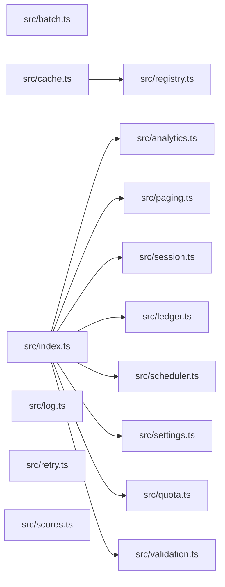

# CodeProof report

Commit: e814a271472b81a207501d0b435d644d14d8fb98  |  run-id: 617e4b4386c6a15a  |  mode: bench

**Publishing rule:** a finding appears under *Verified findings* only if every citation passed L1 and the adversarial verifier confirmed it. This checks provenance and model agreement, not semantic proof. Refuted, uncertain and moderate findings are in rejected.md.

## Summary

| Metric | Value |
|---|---|
| Files / LOC | 15 / 229 |
| Import edges / cycles | 9 / 0 |
| Files in scanner prompt | 15 / 15 |
| Findings proposed | 9 |
| Rejected at L1 (bad citation) | 0 |
| Verified | 9 |
| Reproduced by execution (L3) | 7 |
| Patch-proven (L4, differential) | 7 |
| Moderate confidence | 0 |
| Refuted | 0 |
| Uncertain | 0 |
| Calls / retries | 26 / 0 |
| Tokens in / out | 30932 / 46294 |
| Cached input tokens | 7172 |
| Cost | $0.9186 |

## Verified findings

### F-001 - critical - validation condition always true

**Claim:** validate uses OR between undefined and null checks, so each condition is always true and errors are always reported even for complete payloads.

**Proposed by:** Muse Spark

**Evidence level:** citation-proven + adversarially-confirmed + **execution-proven (generated test fails on the analyzed commit)**

**Execution check:** reproduced by execution: the control passed 3/3 and the trigger failed 3/3 (see Reproduced by execution)

**Citation (from commit, lines 6-15):** src/validation.ts
```text
export function validate(payload: Payload): string[] {
  const errors: string[] = [];
  if (payload.id !== undefined || payload.id !== null) {
    errors.push("id is required");
  }
  if (payload.value !== undefined || payload.value !== null) {
    errors.push("value is required");
  }
  return errors;
}
```

**Verifier (muse-wonder-1.0):** confirm - The conditions at src/validation.ts:8 and src/validation.ts:11 use || between !== undefined and !== null, which is tautologically true for any value, so both errors are always pushed even for complete payloads.

### F-002 - critical - ledger summary accumulates across calls

**Claim:** buildSummary appends to module-level totals then aggregates over all of totals, so repeated calls double-count prior entries.

**Proposed by:** Muse Spark

**Evidence level:** citation-proven + adversarially-confirmed

**Execution check:** inconclusive: reproducer failed L0: controlCode: forbidden console output (it could mask the real failure class); testCode: forbidden console output (it could mask the real failure class)

**Citation (from commit, lines 6-18):** src/ledger.ts
```text
const totals: Entry[] = [];

export function post(entries: Entry[]): void {
  for (const entry of entries) totals.push(entry);
}

export function buildSummary(entries: Entry[]): string {
  post(entries);
  const byAccount = new Map<string, number>();
  for (const entry of totals) {
    byAccount.set(entry.account, (byAccount.get(entry.account) ?? 0) + entry.cents);
  }
  return [...byAccount.entries()].map(([account, cents]) => account + "=" + cents).join(",");
```

**Verifier (muse-wonder-1.0):** confirm - Confirmed: buildSummary at src/ledger.ts:12-15 calls post(entries) which pushes onto the module-level totals array at src/ledger.ts:6-9, then aggregates over all of totals without clearing it, so a second call re-includes prior entries.

### F-003 - high - async forEach never awaited

**Claim:** collect uses forEach with an async callback and returns results immediately, so promises are not awaited and the returned array is empty.

**Proposed by:** Muse Spark

**Evidence level:** citation-proven + adversarially-confirmed + **execution-proven (generated test fails on the analyzed commit)**

**Execution check:** reproduced by execution: the control passed 3/3 and the trigger failed 3/3 (see Reproduced by execution)

**Citation (from commit, lines 3-13):** src/analytics.ts
```text
export async function collect(tasks: Task[]): Promise<number[]> {
  const results: number[] = [];
  try {
    tasks.forEach(async (task) => {
      results.push(await task());
    });
  } catch (error) {
    console.error("analytics collection failed", error);
  }
  return results;
}
```

**Verifier (muse-wonder-1.0):** confirm - The code at src/analytics.ts:6 uses tasks.forEach with an async callback whose push at src/analytics.ts:7 occurs after an await, while src/analytics.ts:12 returns results immediately with no awaiting of those callbacks, so the array is empty at return.

### F-004 - high - missing await on token save

**Claim:** rotateToken calls store.save without await before store.get, so the read can race the write and return a stale token.

**Proposed by:** Muse Spark

**Evidence level:** citation-proven + adversarially-confirmed + **execution-proven (generated test fails on the analyzed commit)**

**Execution check:** reproduced by execution: the control passed 3/3 and the trigger failed 3/3 (see Reproduced by execution)

**Citation (from commit, lines 6-13):** src/session.ts
```text
export async function rotateToken(
  store: SessionStore,
  userId: string,
  token: string,
): Promise<string | undefined> {
  store.save(userId, token);
  return store.get(userId);
}
```

**Verifier (muse-wonder-1.0):** confirm - The interface at src/session.ts:2 declares save returns Promise<void>, and rotateToken at src/session.ts:11 calls store.save without await before returning store.get at src/session.ts:12, so the read can race the pending write.

### F-005 - high - scheduler timer replaced without clear

**Claim:** start overwrites this.timer with a new setInterval without clearing an existing interval, leaking the prior timer on repeated starts.

**Proposed by:** Muse Spark

**Evidence level:** citation-proven + adversarially-confirmed

**Execution check:** inconclusive: reproducer failed L0: controlCode assertion is not tied to a call of an imported symbol; testCode assertion is not tied to a call of an imported symbol; control and trigger must use a different input: control and trigger call the shared symbol(s) with identical arguments

**Citation (from commit, lines 7-11):** src/scheduler.ts
```text
  start(intervalMs: number): void {
    this.timer = setInterval(() => {
      for (const tick of this.ticks) tick();
    }, intervalMs);
  }
```

**Verifier (muse-wonder-1.0):** confirm - start at src/scheduler.ts:7-11 unconditionally assigns this.timer = setInterval(...) with no clearInterval or running check, so a second call orphans the prior interval.

### F-006 - high - page slice off-by-one

**Claim:** pageSlice slices with end+1, returning size+1 elements instead of exactly size elements.

**Proposed by:** Muse Spark

**Evidence level:** citation-proven + adversarially-confirmed + **execution-proven (generated test fails on the analyzed commit)**

**Execution check:** reproduced by execution: the control passed 3/3 and the trigger failed 3/3 (see Reproduced by execution)

**Citation (from commit, lines 6-11):** src/paging.ts
```text
export function pageSlice<T>(items: T[], request: PageRequest): T[] {
  const size = Math.max(1, request.size);
  const start = Math.max(0, request.page) * size;
  const end = start + size;
  return items.slice(start, end + 1);
}
```

**Verifier (muse-wonder-1.0):** confirm - At src/paging.ts:9-10 end is start+size and the return uses items.slice(start, end + 1), so a full page yields size+1 elements instead of size.

### F-007 - high - numeric sort without comparator

**Claim:** sortScores uses default Array.sort without a numeric comparator, so numbers sort lexicographically and topScore can be wrong.

**Proposed by:** Muse Spark

**Evidence level:** citation-proven + adversarially-confirmed + **execution-proven (generated test fails on the analyzed commit)**

**Execution check:** reproduced by execution: the control passed 3/3 and the trigger failed 3/3 (see Reproduced by execution)

**Citation (from commit, lines 1-3):** src/scores.ts
```text
export function sortScores(scores: number[]): number[] {
  return scores.slice().sort();
}
```

**Verifier (muse-wonder-1.0):** confirm - sortScores at src/scores.ts:2 calls scores.slice().sort() with no comparator, so JavaScript sorts numbers lexicographically, and topScore at src/scores.ts:7 returns the last element which can therefore not be the numeric maximum.

### F-008 - high - quota inclusive bound uses strict less-than

**Claim:** withinQuota uses strict less-than while its doc states max is inclusive, so a request using exactly max is incorrectly rejected.

**Proposed by:** Muse Spark

**Evidence level:** citation-proven + adversarially-confirmed + **execution-proven (generated test fails on the analyzed commit)**

**Execution check:** reproduced by execution: the control passed 3/3 and the trigger failed 3/3 (see Reproduced by execution)

**Citation (from commit, lines 1-6):** src/quota.ts
```text
/**
 * Returns true when the request fits. Max is inclusive: a request that uses
 * exactly the maximum is still within quota.
 */
export function withinQuota(used: number, amount: number, max: number): boolean {
  return used + amount < max;
```

**Verifier (muse-wonder-1.0):** confirm - The doc at src/quota.ts:2-3 states max is inclusive, but src/quota.ts:6 returns used + amount < max, which is false when the sum equals max.

### F-009 - medium - falsy default discards zero setting

**Claim:** normalizeSettings uses || for defaults, so legitimate 0 values for pageSize and budgetCents are replaced by fallbacks.

**Proposed by:** Muse Spark

**Evidence level:** citation-proven + adversarially-confirmed + **execution-proven (generated test fails on the analyzed commit)**

**Execution check:** reproduced by execution: the control passed 3/3 and the trigger failed 3/3 (see Reproduced by execution)

**Citation (from commit, lines 11-18):** src/settings.ts
```text
export function normalizeSettings(raw: RawSettings): Settings {
  return {
    pageSize: raw.pageSize || 20,
    budgetCents: raw.budgetCents || 1000,
  };
}

// Optional values are read from settings where 0 is a legitimate value.
```

**Verifier (muse-wonder-1.0):** confirm - normalizeSettings at src/settings.ts:13-14 uses raw.pageSize || 20 and raw.budgetCents || 1000, so falsy 0 is replaced by the fallback, and src/settings.ts:18 states 0 is a legitimate value.

## Reproduced by execution

For each finding below, the verifier model wrote two standalone files. They run on a `git archive` snapshot of the analyzed commit inside a permission-model sandbox: no network, no writes, 2 s timeout, three runs each.

- **[CONTROL]** uses a clean, normal input and must pass 3/3. It proves the environment and the way the API is called are valid; if it fails, the finding is reported as `control-failed` and the trigger is never run.
- **[TRIGGER]** uses a different input and must fail 3/3 with an assertion error on the analyzed commit.
- **LinkCheck** (Node 26) runs the trigger under the permission model with inspector coverage and requires that the imported symbol actually executed. Without that linkage proof the finding is not reported as execution-proven.


### F-001 - validation condition always true

**Expected behavior:** validate returns no errors for a complete payload and reports required-field errors for missing fields

**Control (must pass 3/3 on the analyzed commit):**
```js
import assert from 'node:assert/strict';
import { validate } from './src/validation.ts';
const errors = validate({});
assert.deepEqual(errors, ['id is required', 'value is required']);
```

**Trigger (must fail 3/3 with an assertion error on the analyzed commit):**
```js
import assert from 'node:assert/strict';
import { validate } from './src/validation.ts';
const errors = validate({ id: 'abc', value: 42 });
assert.deepEqual(errors, []);
```

**LinkCheck:** proven - the imported symbol executed under inspector coverage.

**Runner output (last of 3 attempts):**
```text
- []

    at file:///tmp/codeproof-repro-5dhBsZ/snapshot/.codeproof-repro.test.mjs:4:8
    at ModuleJob.run (node:internal/modules/esm/module_job:569:25)
    at async node:internal/modules/esm/loader:650:26
    at async asyncRunEntryPointWithESMLoader (node:internal/modules/run_main:101:5) {
  generatedMessage: true,
  code: 'ERR_ASSERTION',
  actual: [ 'id is required', 'value is required' ],
  expected: [],
  operator: 'deepStrictEqual',
  diff: 'simple'
}

Node.js v26.8.2
```

### F-003 - async forEach never awaited

**Expected behavior:** collect should await all tasks and return their resolved values in input order; collect([]) returns [] and collect of delayed tasks returning 1 and 2 returns [1, 2].

**Control (must pass 3/3 on the analyzed commit):**
```js
import assert from 'node:assert/strict';
import { collect } from './src/analytics.ts';
const result = await collect([]);
assert.deepEqual(result, []);
assert.equal(result.length, 0);
```

**Trigger (must fail 3/3 with an assertion error on the analyzed commit):**
```js
import assert from 'node:assert/strict';
import { collect } from './src/analytics.ts';
const delayed = (value, ms) => async () => {
  await new Promise((resolve) => setTimeout(resolve, ms));
  return value;
};
const result = await collect([delayed(1, 20), delayed(2, 10)]);
assert.deepEqual(result, [1, 2]);
```

**LinkCheck:** proven - the imported symbol executed under inspector coverage.

**Runner output (last of 3 attempts):**
```text
- [
-   1,
-   2
- ]

    at file:///tmp/codeproof-repro-lm6t90/snapshot/.codeproof-repro.test.mjs:8:8 {
  generatedMessage: true,
  code: 'ERR_ASSERTION',
  actual: [],
  expected: [ 1, 2 ],
  operator: 'deepStrictEqual',
  diff: 'simple'
}

Node.js v26.8.2
```

### F-004 - missing await on token save

**Expected behavior:** rotateToken returns the newly saved token after saving it

**Control (must pass 3/3 on the analyzed commit):**
```js
import assert from 'node:assert/strict';
import { rotateToken } from './src/session.ts';
let stored = 'old-token';
const store = {
  async save(userId, token) { stored = token; },
  async get(userId) { return stored; }
};
const result = await rotateToken(store, 'alice', 'fresh-token');
assert.equal(result, 'fresh-token');
```

**Trigger (must fail 3/3 with an assertion error on the analyzed commit):**
```js
import assert from 'node:assert/strict';
import { rotateToken } from './src/session.ts';
let stored = 'stale-token';
const store = {
  async save(userId, token) { await new Promise((r) => setTimeout(r, 20)); stored = token; },
  async get(userId) { return stored; }
};
const result = await rotateToken(store, 'bob', 'rotated-token');
assert.equal(result, 'rotated-token');
```

**LinkCheck:** proven - the imported symbol executed under inspector coverage.

**Runner output (last of 3 attempts):**
```text
+ actual - expected

+ 'stale-token'
- 'rotated-token'

    at file:///tmp/codeproof-repro-a0aRVR/snapshot/.codeproof-repro.test.mjs:9:8 {
  generatedMessage: true,
  code: 'ERR_ASSERTION',
  actual: 'stale-token',
  expected: 'rotated-token',
  operator: 'strictEqual',
  diff: 'simple'
}

Node.js v26.8.2
```

### F-006 - page slice off-by-one

**Expected behavior:** pageSlice returns exactly `size` elements for a full page (fewer only at the end of the array).

**Control (must pass 3/3 on the analyzed commit):**
```js
import assert from 'node:assert/strict';
import { pageSlice } from './src/paging.ts';
const result = pageSlice([1, 2, 3], { page: 0, size: 3 });
assert.deepEqual(result, [1, 2, 3]);
assert.equal(result.length, 3);
```

**Trigger (must fail 3/3 with an assertion error on the analyzed commit):**
```js
import assert from 'node:assert/strict';
import { pageSlice } from './src/paging.ts';
const result = pageSlice([1, 2, 3, 4, 5, 6, 7, 8, 9, 10], { page: 0, size: 3 });
assert.deepEqual(result, [1, 2, 3]);
assert.equal(result.length, 3);
```

**LinkCheck:** proven - the imported symbol executed under inspector coverage.

**Runner output (last of 3 attempts):**
```text
  ]

    at file:///tmp/codeproof-repro-CT2plP/snapshot/.codeproof-repro.test.mjs:4:8
    at ModuleJob.run (node:internal/modules/esm/module_job:569:25)
    at async node:internal/modules/esm/loader:650:26
    at async asyncRunEntryPointWithESMLoader (node:internal/modules/run_main:101:5) {
  generatedMessage: true,
  code: 'ERR_ASSERTION',
  actual: [ 1, 2, 3, 4 ],
  expected: [ 1, 2, 3 ],
  operator: 'deepStrictEqual',
  diff: 'simple'
}

Node.js v26.8.2
```

### F-007 - numeric sort without comparator

**Expected behavior:** sortScores returns numbers sorted in ascending numeric order, so topScore (last element) is the maximum.

**Control (must pass 3/3 on the analyzed commit):**
```js
import assert from 'node:assert/strict';
import { sortScores } from './src/scores.ts';
const sorted = sortScores([3, 1, 2]);
assert.deepEqual(sorted, [1, 2, 3]);
```

**Trigger (must fail 3/3 with an assertion error on the analyzed commit):**
```js
import assert from 'node:assert/strict';
import { sortScores } from './src/scores.ts';
const sorted = sortScores([10, 9, 100]);
assert.deepEqual(sorted, [9, 10, 100]);
```

**LinkCheck:** proven - the imported symbol executed under inspector coverage.

**Runner output (last of 3 attempts):**
```text
  ]

    at file:///tmp/codeproof-repro-gPRK9R/snapshot/.codeproof-repro.test.mjs:4:8
    at ModuleJob.run (node:internal/modules/esm/module_job:569:25)
    at async node:internal/modules/esm/loader:650:26
    at async asyncRunEntryPointWithESMLoader (node:internal/modules/run_main:101:5) {
  generatedMessage: true,
  code: 'ERR_ASSERTION',
  actual: [ 10, 100, 9 ],
  expected: [ 9, 10, 100 ],
  operator: 'deepStrictEqual',
  diff: 'simple'
}

Node.js v26.8.2
```

### F-008 - quota inclusive bound uses strict less-than

**Expected behavior:** withinQuota returns true when used+amount is below or exactly equal to max (inclusive), and false when above max.

**Control (must pass 3/3 on the analyzed commit):**
```js
import assert from 'node:assert/strict';
import { withinQuota } from './src/quota.ts';
const result = withinQuota(2, 3, 10);
assert.equal(result, true);
const over = withinQuota(8, 3, 10);
assert.equal(over, false);
```

**Trigger (must fail 3/3 with an assertion error on the analyzed commit):**
```js
import assert from 'node:assert/strict';
import { withinQuota } from './src/quota.ts';
const result = withinQuota(5, 5, 10);
assert.equal(result, true);
const exact = withinQuota(0, 10, 10);
assert.equal(exact, true);
```

**LinkCheck:** proven - the imported symbol executed under inspector coverage.

**Runner output (last of 3 attempts):**
```text
false !== true

    at file:///tmp/codeproof-repro-FzIRkr/snapshot/.codeproof-repro.test.mjs:4:8
    at ModuleJob.run (node:internal/modules/esm/module_job:569:25)
    at async node:internal/modules/esm/loader:650:26
    at async asyncRunEntryPointWithESMLoader (node:internal/modules/run_main:101:5) {
  generatedMessage: true,
  code: 'ERR_ASSERTION',
  actual: false,
  expected: true,
  operator: 'strictEqual',
  diff: 'simple'
}

Node.js v26.8.2
```

### F-009 - falsy default discards zero setting

**Expected behavior:** normalizeSettings preserves legitimate values and applies defaults only when values are absent; 0 is a legitimate value for pageSize and budgetCents.

**Control (must pass 3/3 on the analyzed commit):**
```js
import assert from 'node:assert/strict';
import { normalizeSettings } from './src/settings.ts';
const result = normalizeSettings({ pageSize: 10, budgetCents: 500 });
assert.equal(result.pageSize, 10);
assert.equal(result.budgetCents, 500);
const defaults = normalizeSettings({});
assert.equal(defaults.pageSize, 20);
assert.equal(defaults.budgetCents, 1000);
```

**Trigger (must fail 3/3 with an assertion error on the analyzed commit):**
```js
import assert from 'node:assert/strict';
import { normalizeSettings } from './src/settings.ts';
const result = normalizeSettings({ pageSize: 0, budgetCents: 0 });
assert.equal(result.pageSize, 0);
assert.equal(result.budgetCents, 0);
```

**LinkCheck:** proven - the imported symbol executed under inspector coverage.

**Runner output (last of 3 attempts):**
```text
20 !== 0

    at file:///tmp/codeproof-repro-Kv0uoJ/snapshot/.codeproof-repro.test.mjs:4:8
    at ModuleJob.run (node:internal/modules/esm/module_job:569:25)
    at async node:internal/modules/esm/loader:650:26
    at async asyncRunEntryPointWithESMLoader (node:internal/modules/run_main:101:5) {
  generatedMessage: true,
  code: 'ERR_ASSERTION',
  actual: 20,
  expected: 0,
  operator: 'strictEqual',
  diff: 'simple'
}

Node.js v26.8.2
```

## Patch-proven (differential proof)

For each finding below the patcher model proposed a minimal patch to one of the cited files. The patch is applied to a **copy** of the L3 snapshot (the snapshot itself is never mutated) and both phases are re-run: the control must still pass 3/3 and the trigger must now pass 3/3. This is a differential result over the reproduction - it does not claim to fix the root cause, and the repository's own test suite is not run.

### F-001 - validation condition always true

**Patch rationale:** The !== undefined || !== null conditions are always true; errors should be reported only when the field is undefined or null, so change !== to ===.

```diff
--- a/src/validation.ts
+++ b/src/validation.ts
@@ -8,4 +8,4 @@
-  if (payload.id !== undefined || payload.id !== null) {
-    errors.push("id is required");
-  }
-  if (payload.value !== undefined || payload.value !== null) {
+  if (payload.id === undefined || payload.id === null) {
+    errors.push("id is required");
+  }
+  if (payload.value === undefined || payload.value === null) {
```

**Differential result:** control passed 3/3, trigger passed 3/3 after the patch. The repository's own test suite was not run; the patch was never written to the analyzed repository.

### F-003 - async forEach never awaited

**Patch rationale:** Replace async forEach (which returns before callbacks finish and would push in completion order) with a sequential awaited for...of loop, preserving input order and the existing try/catch.

```diff
--- a/src/analytics.ts
+++ b/src/analytics.ts
@@ -6,3 +6,3 @@
-    tasks.forEach(async (task) => {
-      results.push(await task());
-    });
+    for (const task of tasks) {
+      results.push(await task());
+    }
```

**Differential result:** control passed 3/3, trigger passed 3/3 after the patch. The repository's own test suite was not run; the patch was never written to the analyzed repository.

### F-004 - missing await on token save

**Patch rationale:** Await the asynchronous save so it completes before reading the token back.

```diff
--- a/src/session.ts
+++ b/src/session.ts
@@ -11,1 +11,1 @@
-  store.save(userId, token);
+  await store.save(userId, token);
```

**Differential result:** control passed 3/3, trigger passed 3/3 after the patch. The repository's own test suite was not run; the patch was never written to the analyzed repository.

### F-006 - page slice off-by-one

**Patch rationale:** Remove the +1 from the slice end so pageSlice returns exactly size elements.

```diff
--- a/src/paging.ts
+++ b/src/paging.ts
@@ -10,1 +10,1 @@
-  return items.slice(start, end + 1);
+  return items.slice(start, end);
```

**Differential result:** control passed 3/3, trigger passed 3/3 after the patch. The repository's own test suite was not run; the patch was never written to the analyzed repository.

### F-007 - numeric sort without comparator

**Patch rationale:** Use numeric comparator instead of default lexicographic sort.

```diff
--- a/src/scores.ts
+++ b/src/scores.ts
@@ -2,1 +2,1 @@
-  return scores.slice().sort();
+  return scores.slice().sort((a, b) => a - b);
```

**Differential result:** control passed 3/3, trigger passed 3/3 after the patch. The repository's own test suite was not run; the patch was never written to the analyzed repository.

### F-008 - quota inclusive bound uses strict less-than

**Patch rationale:** Change strict less-than to less-than-or-equal so exactly max is within quota as documented.

```diff
--- a/src/quota.ts
+++ b/src/quota.ts
@@ -6,1 +6,1 @@
-  return used + amount < max;
+  return used + amount <= max;
```

**Differential result:** control passed 3/3, trigger passed 3/3 after the patch. The repository's own test suite was not run; the patch was never written to the analyzed repository.

### F-009 - falsy default discards zero setting

**Patch rationale:** Use nullish coalescing so 0 is preserved while undefined still falls back to defaults.

```diff
--- a/src/settings.ts
+++ b/src/settings.ts
@@ -13,2 +13,2 @@
-    pageSize: raw.pageSize || 20,
-    budgetCents: raw.budgetCents || 1000,
+    pageSize: raw.pageSize ?? 20,
+    budgetCents: raw.budgetCents ?? 1000,
```

**Differential result:** control passed 3/3, trigger passed 3/3 after the patch. The repository's own test suite was not run; the patch was never written to the analyzed repository.

## Architecture

Deterministic facts only: 15 files, 229 LOC, 9 import edges, 0 cycles. The diagram is generated from the import graph by code, never by the model.



## Limits

- Scan and verify are static: the analyzed code is never executed while the scanner and verifier run. L3 runs only the generated test, on a git-archive snapshot, inside a permission-model sandbox (no network, no writes, 2 s timeout); isolation is process-level, not OS-level.
- No completeness claim; this report shows what passed the gate, not everything that exists in the repository.
- Only direct correctness defects; omission, security and style findings are out of scope for this milestone.
- The L1 gate proves that a citation exists in the commit; the semantic match is judged by the verifier model and presented as such.

