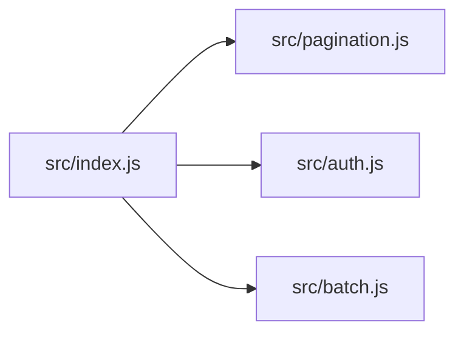

# CodeProof report

Commit: f18b949b845ec8abdbbb70439c82833727c4bcc5  |  run-id: 72becdf8e629b60f  |  mode: smoke

**Publishing rule:** a finding appears under *Verified findings* only if every citation passed L1 and the adversarial verifier confirmed it. This checks provenance and model agreement, not semantic proof. Refuted, uncertain and moderate findings are in rejected.md.

## Summary

| Metric | Value |
|---|---|
| Files / LOC | 4 / 21 |
| Import edges / cycles | 3 / 0 |
| Files in scanner prompt | 4 / 4 |
| Findings proposed | 1 |
| Rejected at L1 (bad citation) | 0 |
| Verified | 1 |
| Reproduced by execution (L3) | 1 |
| Patch-proven (L4, differential) | 1 |
| Moderate confidence | 0 |
| Refuted | 0 |
| Uncertain | 0 |
| Calls / retries | 4 / 0 |
| Tokens in / out | 2829 / 5126 |
| Cached input tokens | 872 |
| Cost | $0.0845 |

## Verified findings

### F-001 - medium - Pagination slice off-by-one returns extra element

**Claim:** slice end uses start + size + 1, so each page returns size+1 elements instead of size

**Proposed by:** Muse Spark

**Evidence level:** citation-proven + adversarially-confirmed + **execution-proven (generated test fails on the analyzed commit)**

**Execution check:** reproduced by execution: the control passed 3/3 and the trigger failed 3/3 (see Reproduced by execution)

**Citation (from commit, lines 3-3):** src/pagination.js
```text
  return items.slice(start, start + size + 1);
```

**Verifier (muse-wonder-1.0):** confirm - The code at src/pagination.js:3 uses slice(start, start + size + 1), whose exclusive end yields size+1 elements when available.

## Reproduced by execution

For each finding below, the verifier model wrote two standalone files. They run on a `git archive` snapshot of the analyzed commit inside a permission-model sandbox: no network, no writes, 2 s timeout, three runs each.

- **[CONTROL]** uses a clean, normal input and must pass 3/3. It proves the environment and the way the API is called are valid; if it fails, the finding is reported as `control-failed` and the trigger is never run.
- **[TRIGGER]** uses a different input and must fail 3/3 with an assertion error on the analyzed commit.
- **LinkCheck** (Node 26) runs the trigger under the permission model with inspector coverage and requires that the imported symbol actually executed. Without that linkage proof the finding is not reported as execution-proven.


### F-001 - Pagination slice off-by-one returns extra element

**Expected behavior:** page(items, pageNumber, size) returns exactly size elements for the requested page (fewer only at the end of the array)

**Control (must pass 3/3 on the analyzed commit):**
```js
import assert from 'node:assert/strict';
import { page } from './src/pagination.js';
const result = page([1, 2, 3], 0, 3);
assert.deepEqual(result, [1, 2, 3]);
assert.equal(result.length, 3);
```

**Trigger (must fail 3/3 with an assertion error on the analyzed commit):**
```js
import assert from 'node:assert/strict';
import { page } from './src/pagination.js';
const result = page([1, 2, 3, 4, 5], 0, 2);
assert.deepEqual(result, [1, 2]);
assert.equal(result.length, 2);
```

**LinkCheck:** proven - the imported symbol executed under inspector coverage.

**Runner output (last of 3 attempts):**
```text
  ]

    at file:///tmp/codeproof-repro-G3uhfm/snapshot/.codeproof-repro.test.mjs:4:8
    at ModuleJob.run (node:internal/modules/esm/module_job:569:25)
    at async node:internal/modules/esm/loader:650:26
    at async asyncRunEntryPointWithESMLoader (node:internal/modules/run_main:101:5) {
  generatedMessage: true,
  code: 'ERR_ASSERTION',
  actual: [ 1, 2, 3 ],
  expected: [ 1, 2 ],
  operator: 'deepStrictEqual',
  diff: 'simple'
}

Node.js v26.8.2
```

## Patch-proven (differential proof)

For each finding below the patcher model proposed a minimal patch to one of the cited files. The patch is applied to a **copy** of the L3 snapshot (the snapshot itself is never mutated) and both phases are re-run: the control must still pass 3/3 and the trigger must now pass 3/3. This is a differential result over the reproduction - it does not claim to fix the root cause, and the repository's own test suite is not run.

### F-001 - Pagination slice off-by-one returns extra element

**Patch rationale:** Remove the +1 from the slice end index so a page returns exactly size elements.

```diff
--- a/src/pagination.js
+++ b/src/pagination.js
@@ -3,1 +3,1 @@
-  return items.slice(start, start + size + 1);
+  return items.slice(start, start + size);
```

**Differential result:** control passed 3/3, trigger passed 3/3 after the patch. The repository's own test suite was not run; the patch was never written to the analyzed repository.

## Architecture

Deterministic facts only: 4 files, 21 LOC, 3 import edges, 0 cycles. The diagram is generated from the import graph by code, never by the model.



## Limits

- Scan and verify are static: the analyzed code is never executed while the scanner and verifier run. L3 runs only the generated test, on a git-archive snapshot, inside a permission-model sandbox (no network, no writes, 2 s timeout); isolation is process-level, not OS-level.
- No completeness claim; this report shows what passed the gate, not everything that exists in the repository.
- Only direct correctness defects; omission, security and style findings are out of scope for this milestone.
- The L1 gate proves that a citation exists in the commit; the semantic match is judged by the verifier model and presented as such.

