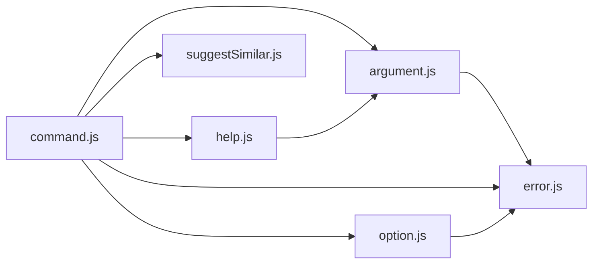

# CodeProof report

Commit: 395cf7145fe28122f5a69026b310e02df114f907  |  run-id: 2be86e38745c0256  |  mode: smoke

**Publishing rule:** a finding appears under *Verified findings* only if every citation passed L1 and the adversarial verifier confirmed it. This checks provenance and model agreement, not semantic proof. Refuted, uncertain and moderate findings are in rejected.md.

## Summary

| Metric | Value |
|---|---|
| Files / LOC | 6 / 4193 |
| Import edges / cycles | 8 / 0 |
| Files in scanner prompt | 6 / 6 |
| Findings proposed | 1 |
| Rejected at L1 (bad citation) | 0 |
| Verified | 1 |
| Reproduced by execution (L3) | 0 |
| Moderate confidence | 0 |
| Refuted | 0 |
| Uncertain | 0 |
| Calls / retries | 4 / 0 |
| Tokens in / out | 107270 / 34629 |
| Cached input tokens | 29916 |
| Cost | $0.6957 |

## Verified findings

### F-001 - high - Signal listeners accumulate on repeated subcommand execution

**Claim:** _executeSubCommand adds 5 process signal forwarders on every call and never removes them, so a second execution double-counts signals and leaks listeners.

**Proposed by:** Muse Spark

**Evidence level:** citation-proven + adversarially-confirmed

**Execution check:** inconclusive: reproducer failed L0: controlCode assertion is not tied to a call of an imported symbol; controlCode: forbidden process access; testCode assertion is not tied to a call of an imported symbol; testCode: forbidden process access; control and trigger must use a different input: control and trigger call the shared symbol(s) with identical arguments

**Citation (from commit, lines 1291-1301):** command.js
```text
    if (!proc.killed) {
      // testing mainly to avoid leak warnings during unit tests with mocked spawn
      const signals = ['SIGUSR1', 'SIGUSR2', 'SIGTERM', 'SIGINT', 'SIGHUP'];
      signals.forEach((signal) => {
        process.on(signal, () => {
          if (proc.killed === false && proc.exitCode === null) {
            // @ts-ignore because signals not typed to known strings
            proc.kill(signal);
          }
        });
      });
```

**Verifier (muse-wonder-1.0):** confirm - The code at command.js:1291-1301 registers process.on handlers for five signals on every _executeSubCommand call, and the close/error handlers at command.js:1306-1343 contain no process.removeListener/off cleanup, so repeated executions accumulate listeners.

## Architecture

Deterministic facts only: 6 files, 4193 LOC, 8 import edges, 0 cycles. The diagram is generated from the import graph by code, never by the model.



## Limits

- Scan and verify are static: the analyzed code is never executed while the scanner and verifier run. L3 runs only the generated test, on a git-archive snapshot, inside a permission-model sandbox (no network, no writes, 2 s timeout); isolation is process-level, not OS-level.
- No completeness claim; this report shows what passed the gate, not everything that exists in the repository.
- Only direct correctness defects; omission, security and style findings are out of scope for this milestone.
- The L1 gate proves that a citation exists in the commit; the semantic match is judged by the verifier model and presented as such.

