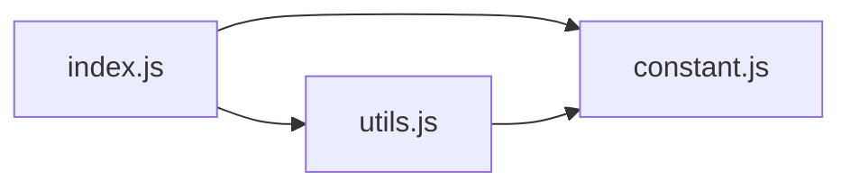

# CodeProof report

Commit: 912f55da6d17347993dbdf0f3dbc0d3ae3f3949b  |  run-id: 06b068c398a60ae7  |  mode: smoke

**Publishing rule:** a finding appears under *Verified findings* only if every citation passed L1 and the adversarial verifier confirmed it. This checks provenance and model agreement, not semantic proof. Refuted, uncertain and moderate findings are in rejected.md.

## Summary

| Metric | Value |
|---|---|
| Files / LOC | 3 / 548 |
| Import edges / cycles | 3 / 0 |
| Files in scanner prompt | 3 / 3 |
| Findings proposed | 3 |
| Rejected at L1 (bad citation) | 0 |
| Verified | 3 |
| Reproduced by execution (L3) | 0 |
| Moderate confidence | 0 |
| Refuted | 0 |
| Uncertain | 0 |
| Calls / retries | 8 / 0 |
| Tokens in / out | 37648 / 53518 |
| Cached input tokens | 1872 |
| Cost | $0.6194 |

## Verified findings

### F-001 - critical - Null options object crashes factory

**Claim:** dayjs(date, null) throws TypeError because typeof null is 'object', so cfg becomes null and the next line assigns cfg.date.

**Proposed by:** Muse Spark

**Evidence level:** citation-proven + adversarially-confirmed

**Execution check:** inconclusive: reproducer failed L0: controlCode assertion is not tied to a call of an imported symbol; testCode assertion is not tied to a call of an imported symbol

**Citation (from commit, lines 41-42):** index.js
```text
  const cfg = typeof c === 'object' ? c : {}
  cfg.date = date
```

**Verifier (muse-wonder-1.0):** confirm - Confirmed: index.js:41 assigns cfg = c when typeof c === 'object', which is true for null, and index.js:42 then assigns cfg.date on null, throwing a TypeError.

### F-002 - high - Locale fallback loses isLocal and mutates global

**Claim:** Fallback for hyphenated locale drops isLocal, so instance locale() with e.g. 'en-US' falling back to 'en' executes parseLocale('en') with isLocal falsy and overwrites global L.

**Proposed by:** Muse Spark

**Evidence level:** citation-proven + adversarially-confirmed

**Execution check:** inconclusive: reproducer failed L0: control and trigger must use a different input: control and trigger call the shared symbol(s) with identical arguments

**Citation (from commit, lines 11-12):** index.js
```text
const parseLocale = (preset, object, isLocal) => {
  let l
```
**Citation (from commit, lines 23-26):** index.js
```text
    const presetSplit = preset.split('-')
    if (!l && presetSplit.length > 1) {
      return parseLocale(presetSplit[0])
    }
```

**Verifier (muse-wonder-1.0):** confirm - The recursive fallback at index.js:25 calls parseLocale(presetSplit[0]) without passing object or isLocal, so a local call reaches index.js:32 where !isLocal is true and assigns the fallback locale to global L.

### F-003 - medium - Millisecond fraction not padded to 3 digits

**Claim:** Fractional seconds with 1-2 digits are not scaled to milliseconds: '.1' becomes 1ms instead of 100ms and '.12' becomes 12ms instead of 120ms because ms is truncated but never padded.

**Proposed by:** Muse Spark

**Evidence level:** citation-proven + adversarially-confirmed

**Execution check:** inconclusive: reproducer failed L0: controlCode must bind at least one symbol from the repository import; controlCode assertion is not tied to a call of an imported symbol; testCode must bind at least one symbol from the repository import; testCode assertion is not tied to a call of an imported symbol

**Citation (from commit, lines 69-72):** index.js
```text
      const ms = (d[7] || '0').substring(0, 3)
      if (utc) {
        return new Date(Date.UTC(d[1], m, d[3]
          || 1, d[4] || 0, d[5] || 0, d[6] || 0, ms))
```

**Verifier (muse-wonder-1.0):** confirm - Confirmed: at index.js:69 ms is only truncated via substring(0,3) with no right-padding, and the resulting string is passed directly as the milliseconds argument at index.js:72 and index.js:75, so the fractional group captured by constant.js:29 as '1' or '12' becomes 1ms or 12ms instead of 100ms or 120ms.

## Architecture

Deterministic facts only: 3 files, 548 LOC, 3 import edges, 0 cycles. The diagram is generated from the import graph by code, never by the model.



## Limits

- Scan and verify are static: the analyzed code is never executed while the scanner and verifier run. L3 runs only the generated test, on a git-archive snapshot, inside a permission-model sandbox (no network, no writes, 2 s timeout); isolation is process-level, not OS-level.
- No completeness claim; this report shows what passed the gate, not everything that exists in the repository.
- Only direct correctness defects; omission, security and style findings are out of scope for this milestone.
- The L1 gate proves that a citation exists in the commit; the semantic match is judged by the verifier model and presented as such.

