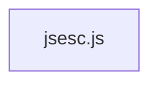

# CodeProof report

Commit: e3349b542eaaf55239cb60519991b80097cee24b  |  run-id: b0941ba03c256e66  |  mode: smoke

**Publishing rule:** a finding appears under *Verified findings* only if every citation passed L1 and the adversarial verifier confirmed it. This checks provenance and model agreement, not semantic proof. Refuted, uncertain and moderate findings are in rejected.md.

## Summary

| Metric | Value |
|---|---|
| Files / LOC | 1 / 337 |
| Import edges / cycles | 0 / 0 |
| Files in scanner prompt | 1 / 1 |
| Findings proposed | 1 |
| Rejected at L1 (bad citation) | 0 |
| Verified | 1 |
| Reproduced by execution (L3) | 1 |
| Moderate confidence | 0 |
| Refuted | 0 |
| Uncertain | 0 |
| Calls / retries | 4 / 0 |
| Tokens in / out | 10943 / 21629 |
| Cached input tokens | 500 |
| Cost | $0.2588 |

## Verified findings

### F-001 - high - Negative numbers with hexadecimal/binary/octal produce invalid literals

**Claim:** For negative numbers argument.toString(2/8/16) returns a string with leading '-', so '0x'+hex, '0b'+bin and '0o'+oct produce invalid literals like '0x-A' and '0b-101' instead of '-0xA' and '-0b101'.

**Proposed by:** Muse Spark

**Evidence level:** citation-proven + adversarially-confirmed + **execution-proven (generated test fails on the analyzed commit)**

**Execution check:** reproduced by execution: the control passed 3/3 and the trigger failed 3/3 (see Reproduced by execution)

**Citation (from commit, lines 221-221):** jsesc.js
```text
				result = '0x' + hexadecimal;
```
**Citation (from commit, lines 223-223):** jsesc.js
```text
				result = '0b' + argument.toString(2);
```
**Citation (from commit, lines 225-225):** jsesc.js
```text
				result = '0o' + argument.toString(8);
```

**Verifier (muse-wonder-1.0):** confirm - The code at jsesc.js:217-225 directly prefixes '0x'/'0b'/'0o' to argument.toString(16/2/8) with no sign handling, so a negative value whose toString yields a leading '-' produces invalid literals like '0x-A'.

## Reproduced by execution

For each finding below, the verifier model wrote two standalone files. They run on a `git archive` snapshot of the analyzed commit inside a permission-model sandbox: no network, no writes, 2 s timeout, three runs each.

- **[CONTROL]** uses a clean, normal input and must pass 3/3. It proves the environment and the way the API is called are valid; if it fails, the finding is reported as `control-failed` and the trigger is never run.
- **[TRIGGER]** uses a different input and must fail 3/3 with an assertion error on the analyzed commit.
- **LinkCheck** (Node 26) runs the trigger under the permission model with inspector coverage and requires that the imported symbol actually executed. Without that linkage proof the finding is not reported as execution-proven.


### F-001 - Negative numbers with hexadecimal/binary/octal produce invalid literals

**Expected behavior:** Positive numbers are formatted as valid prefixed literals (0xA, 0b101, 0o10), and negative numbers should place the minus sign before the prefix (-0xA, -0b101, -0o10).

**Control (must pass 3/3 on the analyzed commit):**
```js
import assert from 'node:assert/strict';
import jsesc from './jsesc.js';
const hex = jsesc(10, { numbers: 'hexadecimal' });
assert.equal(hex, '0xA');
const bin = jsesc(5, { numbers: 'binary' });
assert.equal(bin, '0b101');
const oct = jsesc(8, { numbers: 'octal' });
assert.equal(oct, '0o10');
```

**Trigger (must fail 3/3 with an assertion error on the analyzed commit):**
```js
import assert from 'node:assert/strict';
import jsesc from './jsesc.js';
const hex = jsesc(-10, { numbers: 'hexadecimal' });
assert.equal(hex, '-0xA');
const bin = jsesc(-5, { numbers: 'binary' });
assert.equal(bin, '-0b101');
const oct = jsesc(-8, { numbers: 'octal' });
assert.equal(oct, '-0o10');
```

**LinkCheck:** proven - the imported symbol executed under inspector coverage.

**Runner output (last of 3 attempts):**
```text
'0x-A' !== '-0xA'

    at file:///tmp/codeproof-repro-MPQ6Xg/snapshot/.codeproof-repro.test.mjs:4:8
    at ModuleJob.run (node:internal/modules/esm/module_job:569:25)
    at async node:internal/modules/esm/loader:650:26
    at async asyncRunEntryPointWithESMLoader (node:internal/modules/run_main:101:5) {
  generatedMessage: true,
  code: 'ERR_ASSERTION',
  actual: '0x-A',
  expected: '-0xA',
  operator: 'strictEqual',
  diff: 'simple'
}

Node.js v26.8.2
```

## Architecture

Deterministic facts only: 1 files, 337 LOC, 0 import edges, 0 cycles. The diagram is generated from the import graph by code, never by the model.



## Limits

- Scan and verify are static: the analyzed code is never executed while the scanner and verifier run. L3 runs only the generated test, on a git-archive snapshot, inside a permission-model sandbox (no network, no writes, 2 s timeout); isolation is process-level, not OS-level.
- No completeness claim; this report shows what passed the gate, not everything that exists in the repository.
- Only direct correctness defects; omission, security and style findings are out of scope for this milestone.
- The L1 gate proves that a citation exists in the commit; the semantic match is judged by the verifier model and presented as such.

