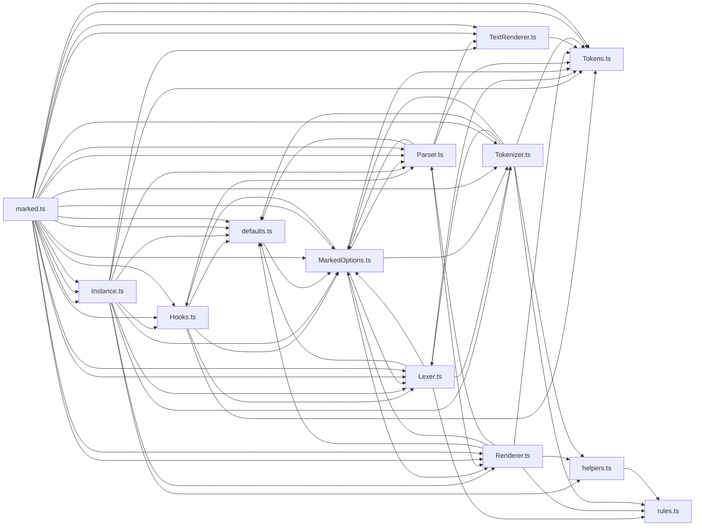

# CodeProof report

Commit: b4eb83bbb48107720d95162ccecf829ba16be91e  |  run-id: 6cd8009a29058221  |  mode: smoke

**Publishing rule:** a finding appears under *Verified findings* only if every citation passed L1 and the adversarial verifier confirmed it. This checks provenance and model agreement, not semantic proof. Refuted, uncertain and moderate findings are in rejected.md.

## Summary

| Metric | Value |
|---|---|
| Files / LOC | 13 / 3344 |
| Import edges / cycles | 67 / 11 |
| Files in scanner prompt | 13 / 13 |
| Findings proposed | 1 |
| Rejected at L1 (bad citation) | 0 |
| Verified | 1 |
| Reproduced by execution (L3) | 0 |
| Moderate confidence | 0 |
| Refuted | 0 |
| Uncertain | 0 |
| Calls / retries | 4 / 0 |
| Tokens in / out | 48533 / 27255 |
| Cached input tokens | 3304 |
| Cost | $0.4661 |

## Verified findings

### F-001 - high - Renderer.listitem mutates tokens causing duplicate checkbox on re-render

**Claim:** listitem mutates the input token in place (prepends checkbox to text and unshifts a new token), so rendering the same tokens a second time prepends/unshifts the checkbox again and double-counts it.

**Proposed by:** Muse Spark

**Evidence level:** citation-proven + adversarially-confirmed

**Execution check:** inconclusive: reproducer failed L0: controlCode assertion is not tied to a call of an imported symbol; testCode assertion is not tied to a call of an imported symbol; control and trigger must use a different input: control and trigger call the shared symbol(s) with identical arguments

**Citation (from commit, lines 80-92):** Renderer.ts
```text
        if (item.tokens[0]?.type === 'paragraph') {
          item.tokens[0].text = checkbox + ' ' + item.tokens[0].text;
          if (item.tokens[0].tokens && item.tokens[0].tokens.length > 0 && item.tokens[0].tokens[0].type === 'text') {
            item.tokens[0].tokens[0].text = checkbox + ' ' + escape(item.tokens[0].tokens[0].text);
            item.tokens[0].tokens[0].escaped = true;
          }
        } else {
          item.tokens.unshift({
            type: 'text',
            raw: checkbox + ' ',
            text: checkbox + ' ',
            escaped: true,
          });
```

**Verifier (muse-wonder-1.0):** confirm - Renderer.ts:80-92 mutates the loose task item in place by prepending the checkbox to paragraph/text token text and by unshifting a new checkbox text token in the else branch, with no guard, clearing of item.task, or already-present check, so calling listitem again on the same tokens at Renderer.ts:75-99 reapplies the checkbox.

## Architecture

Deterministic facts only: 13 files, 3344 LOC, 67 import edges, 11 cycles. The diagram is generated from the import graph by code, never by the model.



## Limits

- Scan and verify are static: the analyzed code is never executed while the scanner and verifier run. L3 runs only the generated test, on a git-archive snapshot, inside a permission-model sandbox (no network, no writes, 2 s timeout); isolation is process-level, not OS-level.
- No completeness claim; this report shows what passed the gate, not everything that exists in the repository.
- Only direct correctness defects; omission, security and style findings are out of scope for this milestone.
- The L1 gate proves that a citation exists in the commit; the semantic match is judged by the verifier model and presented as such.

