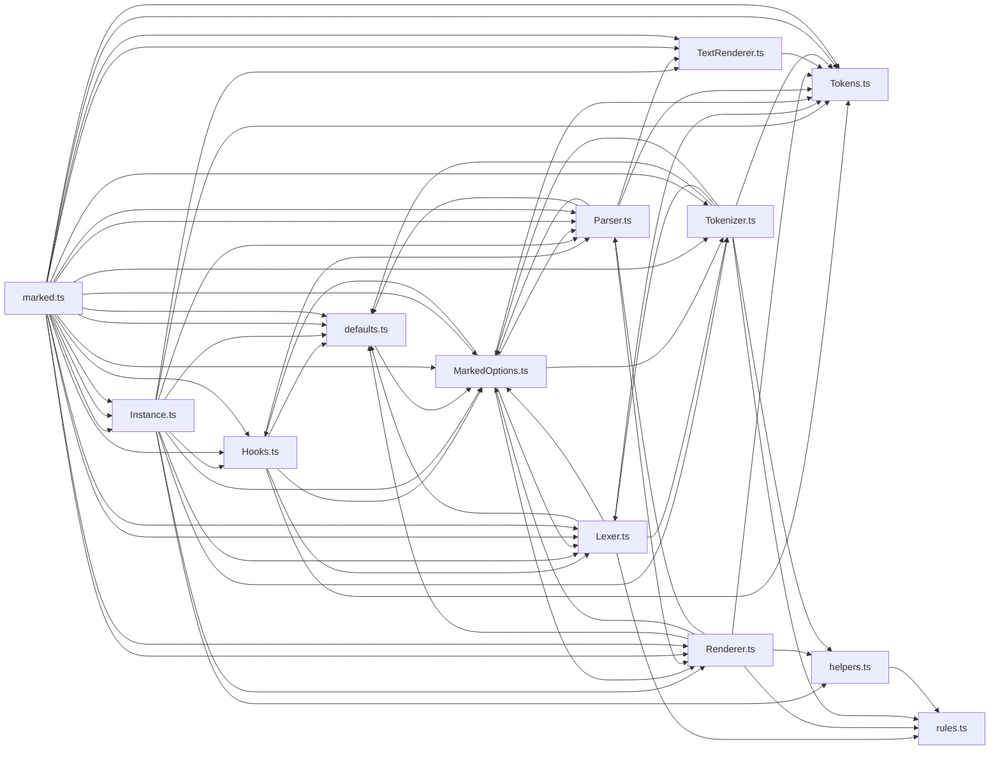

# CodeProof report

Commit: b4eb83bbb48107720d95162ccecf829ba16be91e  |  run-id: 6cd8009a29058221  |  mode: smoke

**Publishing rule:** a finding appears under *Verified findings* only if every citation passed L1 and the adversarial verifier confirmed it. This checks provenance and model agreement, not semantic proof. Refuted, uncertain and moderate findings are in rejected.md.

## Summary

| Metric | Value |
|---|---|
| Files / LOC | 13 / 3344 |
| Import edges / cycles | 67 / 11 |
| Files in scanner prompt | 13 / 13 |
| Findings proposed | 6 |
| Rejected at L1 (bad citation) | 0 |
| Verified | 5 |
| Reproduced by execution (L3) | 0 |
| Moderate confidence | 1 |
| Refuted | 0 |
| Uncertain | 0 |
| Calls / retries | 18 / 0 |
| Tokens in / out | 147970 / 97378 |
| Cached input tokens | 27340 |
| Cost | $2.1797 |

## Verified findings

### F-001 - high - Task list render mutates tokens causing duplicate checkbox

**Claim:** listitem prepends checkbox HTML directly onto token text without guard, so rendering the same tokens twice prepends the checkbox twice and re-escapes already-mutated text

**Proposed by:** Muse Spark

**Evidence level:** citation-proven + adversarially-confirmed

**Execution check:** inconclusive: reproducer failed L0: controlCode assertion is not tied to a call of an imported symbol; testCode assertion is not tied to a call of an imported symbol; control and trigger must use a different input: control and trigger call the shared symbol(s) with identical arguments

**Citation (from commit, lines 80-84):** Renderer.ts
```text
        if (item.tokens[0]?.type === 'paragraph') {
          item.tokens[0].text = checkbox + ' ' + item.tokens[0].text;
          if (item.tokens[0].tokens && item.tokens[0].tokens.length > 0 && item.tokens[0].tokens[0].type === 'text') {
            item.tokens[0].tokens[0].text = checkbox + ' ' + escape(item.tokens[0].tokens[0].text);
            item.tokens[0].tokens[0].escaped = true;
```

**Verifier (muse-wonder-1.0):** confirm - Renderer.ts:81-84 unconditionally assigns checkbox-prefixed text back onto item.tokens[0].text and checkbox plus escape() onto its first text child while setting escaped=true, with no guard against already-prefixed or already-escaped text, so a second render of the same tokens reapplies both mutations.

### F-002 - high - Shared tokenizer lexer pointer overwritten

**Claim:** Lexer constructor reuses options.tokenizer instance and overwrites its options/lexer/rules, so creating a second lexer with shared options corrupts the first lexer's tokenizer

**Proposed by:** Muse Spark

**Evidence level:** citation-proven + adversarially-confirmed

**Execution check:** inconclusive: reproducer failed L0: unsupported response must not include testCode; unsupported response must not include controlCode; unsupportedReason is too short

**Citation (from commit, lines 27-30):** Lexer.ts
```text
    this.options.tokenizer = this.options.tokenizer || new _Tokenizer();
    this.tokenizer = this.options.tokenizer;
    this.tokenizer.options = this.options;
    this.tokenizer.lexer = this;
```

**Verifier (muse-wonder-1.0):** confirm - Lexer.ts:27-30 reuses options.tokenizer without cloning and overwrites tokenizer.options and tokenizer.lexer, and Lexer.ts:55 overwrites tokenizer.rules, so a second _Lexer sharing the same options mutates the first lexer's shared tokenizer.

### F-003 - high - Shared renderer parser pointer overwritten

**Claim:** Parser constructor reuses options.renderer instance and overwrites its options/parser, so creating a second parser with shared options corrupts the first parser's renderer

**Proposed by:** Muse Spark

**Evidence level:** citation-proven + adversarially-confirmed

**Execution check:** inconclusive: reproducer failed L0: controlCode assertion is not tied to a call of an imported symbol; testCode assertion is not tied to a call of an imported symbol

**Citation (from commit, lines 16-19):** Parser.ts
```text
    this.options.renderer = this.options.renderer || new _Renderer();
    this.renderer = this.options.renderer;
    this.renderer.options = this.options;
    this.renderer.parser = this;
```

**Verifier (muse-wonder-1.0):** confirm - The constructor at Parser.ts:16-19 reuses options.renderer without cloning and mutates that shared instance's options and parser fields to the newest parser, so a second _Parser sharing the renderer/options leaves the first parser's renderer pointing at the second parser.

### F-004 - high - Shared hooks object mutated per parse

**Claim:** parseMarkdown mutates shared opt.hooks object block/options fields, so a second parse overwrites the hooks state used by the first parse

**Proposed by:** Muse Spark

**Evidence level:** citation-proven + adversarially-confirmed

**Execution check:** inconclusive: reproducer failed L0: unsupported response must not include testCode; unsupported response must not include controlCode; unsupportedReason is too short

**Citation (from commit, lines 292-295):** Instance.ts
```text
      if (opt.hooks) {
        opt.hooks.options = opt;
        opt.hooks.block = blockType;
      }
```

**Verifier (muse-wonder-1.0):** confirm - Confirmed: Instance.ts:273-274 creates only a shallow copy of options so opt.hooks aliases the shared defaults/passed hooks object, Instance.ts:292-295 mutates that object's options and block fields, and the async path at Instance.ts:300-307 defers processAllTokens/postprocess calls, allowing a concurrent second parse to overwrite state the first parse's hooks can read via Hooks.ts:8-9 and Hooks.ts:45-54.

### F-005 - medium - Link inLink state not saved and restored

**Claim:** outputLink unconditionally sets inLink true then false instead of saving/restoring prior value, so nested link tokenization leaves outer link state incorrectly false

**Proposed by:** Muse Spark

**Evidence level:** citation-proven + adversarially-confirmed

**Execution check:** inconclusive: reproducer failed L0: controlCode assertion is not tied to a call of an imported symbol; testCode assertion is not tied to a call of an imported symbol; control and trigger must use a different input: no shared symbol is called in both codes

**Citation (from commit, lines 17-26):** Tokenizer.ts
```text
  lexer.state.inLink = true;
  const token: Tokens.Link | Tokens.Image = {
    type: cap[0].charAt(0) === '!' ? 'image' : 'link',
    raw,
    href,
    title,
    text,
    tokens: lexer.inlineTokens(text),
  };
  lexer.state.inLink = false;
```

**Verifier (muse-wonder-1.0):** confirm - Tokenizer.ts:17 unconditionally sets lexer.state.inLink = true before lexer.inlineTokens(text) at Tokenizer.ts:24, and Tokenizer.ts:26 unconditionally sets it to false with no saved prior value, so a re-entrant outputLink call for a nested link/image token will clear the outer link's state.

## Architecture

Deterministic facts only: 13 files, 3344 LOC, 67 import edges, 11 cycles. The diagram is generated from the import graph by code, never by the model.



## Limits

- Scan and verify are static: the analyzed code is never executed while the scanner and verifier run. L3 runs only the generated test, on a git-archive snapshot, inside a permission-model sandbox (no network, no writes, 2 s timeout); isolation is process-level, not OS-level.
- No completeness claim; this report shows what passed the gate, not everything that exists in the repository.
- Only direct correctness defects; omission, security and style findings are out of scope for this milestone.
- The L1 gate proves that a citation exists in the commit; the semantic match is judged by the verifier model and presented as such.

