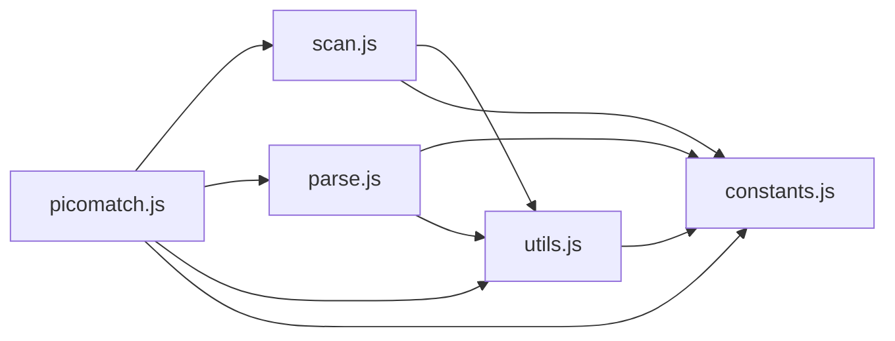

# CodeProof report

Commit: 6bb40679c218cefba5d4e9662408c5fdf699a8bb  |  run-id: 62cbababd7a84e9a  |  mode: smoke

**Publishing rule:** a finding appears under *Verified findings* only if every citation passed L1 and the adversarial verifier confirmed it. This checks provenance and model agreement, not semantic proof. Refuted, uncertain and moderate findings are in rejected.md.

## Summary

| Metric | Value |
|---|---|
| Files / LOC | 5 / 2445 |
| Import edges / cycles | 9 / 0 |
| Files in scanner prompt | 5 / 5 |
| Findings proposed | 3 |
| Rejected at L1 (bad citation) | 0 |
| Verified | 3 |
| Reproduced by execution (L3) | 3 |
| Patch-proven (L4, differential) | 2 |
| Moderate confidence | 0 |
| Refuted | 0 |
| Uncertain | 0 |
| Calls / retries | 11 / 0 |
| Tokens in / out | 77258 / 43854 |
| Cached input tokens | 2092 |
| Cost | $0.9407 |

## Verified findings

### F-001 - medium - Unbalanced closing paren decrements counter below zero

**Claim:** Unmatched ')' pushes escaped output but still decrements state.parens, driving the counter to -1 and corrupting later paren tracking.

**Proposed by:** Muse Spark

**Evidence level:** citation-proven + adversarially-confirmed + **execution-proven (generated test fails on the analyzed commit)**

**Execution check:** reproduced by execution: the control passed 3/3 and the trigger failed 3/3 (see Reproduced by execution)

**Citation (from commit, lines 805-806):** parse.js
```text
      push({ type: 'paren', value, output: state.parens ? ')' : '\\)' });
      decrement('parens');
```

**Verifier (muse-wonder-1.0):** confirm - At parse.js:805 the code pushes escaped '\)' when state.parens is falsy, yet parse.js:806 unconditionally calls decrement('parens') outside the opt-in strictBrackets guard at parse.js:795, so an unmatched ')' drives the counter below zero and affects later paren truthiness checks at parse.js:805.

### F-002 - medium - Falsy zero index skips last token update

**Claim:** Last-token update uses truthiness of prevIndex, so when the only slash is at index 0 the condition is false and token value/depth/maxDepth are never updated.

**Proposed by:** Muse Spark

**Evidence level:** citation-proven + adversarially-confirmed + **execution-proven (generated test fails on the analyzed commit)**

**Execution check:** reproduced by execution: the control passed 3/3 and the trigger failed 3/3 (see Reproduced by execution)

**Citation (from commit, lines 390-394):** scan.js
```text
    if (opts.tokens && prevIndex && prevIndex + 1 < input.length) {
      tokens[tokens.length - 1].value = value;
      depth(tokens[tokens.length - 1]);
      state.maxDepth += tokens[tokens.length - 1].depth;
    }
```

**Verifier (muse-wonder-1.0):** confirm - The code at scan.js:390 gates the final token assignment on truthy prevIndex, while scan.js:382 sets prevIndex to the slash index i, so a sole slash at index 0 leaves prevIndex falsy and skips scan.js:391-393; the trailing token pushed at scan.js:357-359 is not processed by the slash loop at scan.js:366, and scan.js:386 shows the correct prevIndex !== undefined check was available.

### F-003 - medium - noext option incorrectly clears isGlob

**Claim:** With noext:true scan clears isGlob for all patterns, so plain globs like '*' are incorrectly reported as non-globs.

**Proposed by:** Muse Spark

**Evidence level:** citation-proven + adversarially-confirmed + **execution-proven (generated test fails on the analyzed commit)**

**Execution check:** reproduced by execution: the control passed 3/3 and the trigger failed 3/3 (see Reproduced by execution)

**Citation (from commit, lines 301-304):** scan.js
```text
  if (opts.noext === true) {
    isExtglob = false;
    isGlob = false;
  }
```

**Verifier (muse-wonder-1.0):** confirm - The unconditional block at scan.js:301-304 sets isGlob=false whenever opts.noext is true, and the returned state at scan.js:340-353 reports that cleared value after patterns such as brackets set isGlob at scan.js:242-243, so plain globs are reported as non-globs.

## Reproduced by execution

For each finding below, the verifier model wrote two standalone files. They run on a `git archive` snapshot of the analyzed commit inside a permission-model sandbox: no network, no writes, 2 s timeout, three runs each.

- **[CONTROL]** uses a clean, normal input and must pass 3/3. It proves the environment and the way the API is called are valid; if it fails, the finding is reported as `control-failed` and the trigger is never run.
- **[TRIGGER]** uses a different input and must fail 3/3 with an assertion error on the analyzed commit.
- **LinkCheck** (Node 26) runs the trigger under the permission model with inspector coverage and requires that the imported symbol actually executed. Without that linkage proof the finding is not reported as execution-proven.


### F-001 - Unbalanced closing paren decrements counter below zero

**Expected behavior:** A balanced parenthesized group keeps state.parens at 0 and emits an unescaped closing paren; an unmatched ')' is escaped as a literal without driving state.parens below zero, so a later balanced group is still tracked correctly.

**Control (must pass 3/3 on the analyzed commit):**
```js
import assert from 'node:assert/strict';
import parse from './parse.js';

const result = parse('(a)');
assert.equal(result.parens, 0);
assert.equal(result.output, '(a)');
```

**Trigger (must fail 3/3 with an assertion error on the analyzed commit):**
```js
import assert from 'node:assert/strict';
import parse from './parse.js';

const result = parse(')(a)');
assert.equal(result.parens, 0);
assert.equal(result.output.slice(-3), '(a)');
```

**LinkCheck:** proven - the imported symbol executed under inspector coverage.

**Runner output (last of 3 attempts):**
```text
-1 !== 0

    at file:///tmp/codeproof-repro-onyEak/snapshot/.codeproof-repro.test.mjs:5:8
    at ModuleJob.run (node:internal/modules/esm/module_job:569:25)
    at async node:internal/modules/esm/loader:650:26
    at async asyncRunEntryPointWithESMLoader (node:internal/modules/run_main:101:5) {
  generatedMessage: true,
  code: 'ERR_ASSERTION',
  actual: -1,
  expected: 0,
  operator: 'strictEqual',
  diff: 'simple'
}

Node.js v26.8.2
```

### F-002 - Falsy zero index skips last token update

**Expected behavior:** scan with tokens:true sets the last token's value/depth and includes it in maxDepth, regardless of whether the preceding slash is at index 0.

**Control (must pass 3/3 on the analyzed commit):**
```js
import assert from 'node:assert/strict';
import scan from './scan.js';
const result = scan('foo/bar', { tokens: true });
assert.equal(result.tokens[result.tokens.length - 1].value, 'bar');
assert.equal(result.tokens[result.tokens.length - 1].depth, 1);
assert.equal(result.maxDepth, 2);
assert.deepEqual(result.parts, ['foo', 'bar']);
```

**Trigger (must fail 3/3 with an assertion error on the analyzed commit):**
```js
import assert from 'node:assert/strict';
import scan from './scan.js';
const result = scan('/foo', { tokens: true });
assert.equal(result.tokens[result.tokens.length - 1].value, 'foo');
assert.equal(result.tokens[result.tokens.length - 1].depth, 1);
assert.equal(result.maxDepth, 2);
assert.deepEqual(result.parts, ['', 'foo']);
```

**LinkCheck:** proven - the imported symbol executed under inspector coverage.

**Runner output (last of 3 attempts):**
```text
'' !== 'foo'

    at file:///tmp/codeproof-repro-MIJPWO/snapshot/.codeproof-repro.test.mjs:4:8
    at ModuleJob.run (node:internal/modules/esm/module_job:569:25)
    at async node:internal/modules/esm/loader:650:26
    at async asyncRunEntryPointWithESMLoader (node:internal/modules/run_main:101:5) {
  generatedMessage: true,
  code: 'ERR_ASSERTION',
  actual: '',
  expected: 'foo',
  operator: 'strictEqual',
  diff: 'simple'
}

Node.js v26.8.2
```

### F-003 - noext option incorrectly clears isGlob

**Expected behavior:** scan('*') reports isGlob true, and scan('*', {noext:true}) should also report isGlob true with isExtglob false because noext only disables extglobs, not plain globs.

**Control (must pass 3/3 on the analyzed commit):**
```js
import assert from 'node:assert/strict';
import scan from './scan.js';

const result = scan('*');
assert.equal(result.isGlob, true);
assert.equal(result.isExtglob, false);
assert.equal(result.glob, '*');
```

**Trigger (must fail 3/3 with an assertion error on the analyzed commit):**
```js
import assert from 'node:assert/strict';
import scan from './scan.js';

const result = scan('*', { noext: true });
assert.equal(result.isExtglob, false);
assert.equal(result.isGlob, true);
assert.equal(result.glob, '*');
```

**LinkCheck:** proven - the imported symbol executed under inspector coverage.

**Runner output (last of 3 attempts):**
```text
false !== true

    at file:///tmp/codeproof-repro-jM7Q9Z/snapshot/.codeproof-repro.test.mjs:6:8
    at ModuleJob.run (node:internal/modules/esm/module_job:569:25)
    at async node:internal/modules/esm/loader:650:26
    at async asyncRunEntryPointWithESMLoader (node:internal/modules/run_main:101:5) {
  generatedMessage: true,
  code: 'ERR_ASSERTION',
  actual: false,
  expected: true,
  operator: 'strictEqual',
  diff: 'simple'
}

Node.js v26.8.2
```

## Patch-proven (differential proof)

For each finding below the patcher model proposed a minimal patch to one of the cited files. The patch is applied to a **copy** of the L3 snapshot (the snapshot itself is never mutated) and both phases are re-run: the control must still pass 3/3 and the trigger must now pass 3/3. This is a differential result over the reproduction - it does not claim to fix the root cause, and the repository's own test suite is not run.

### F-001 - Unbalanced closing paren decrements counter below zero

**Patch rationale:** Unmatched ')' should not decrement the paren counter below zero; guard the decrement so later '(' tracking remains correct while preserving the escaped output.

```diff
--- a/parse.js
+++ b/parse.js
@@ -806,1 +806,1 @@
-      decrement('parens');
+      if (state.parens > 0) decrement('parens');
```

**Differential result:** control passed 3/3, trigger passed 3/3 after the patch. The repository's own test suite was not run; the patch was never written to the analyzed repository.

**Warnings:** replaceBlock contains literals that also appear in the generated test (possible overfitting): 0

### F-003 - noext option incorrectly clears isGlob

**Patch rationale:** noext should only disable extglob detection, not clear isGlob for plain globs like '*'.

```diff
--- a/scan.js
+++ b/scan.js
@@ -303,1 +302,0 @@
-    isGlob = false;
```

**Differential result:** control passed 3/3, trigger passed 3/3 after the patch. The repository's own test suite was not run; the patch was never written to the analyzed repository.

## Architecture

Deterministic facts only: 5 files, 2445 LOC, 9 import edges, 0 cycles. The diagram is generated from the import graph by code, never by the model.



## Limits

- Scan and verify are static: the analyzed code is never executed while the scanner and verifier run. L3 runs only the generated test, on a git-archive snapshot, inside a permission-model sandbox (no network, no writes, 2 s timeout); isolation is process-level, not OS-level.
- No completeness claim; this report shows what passed the gate, not everything that exists in the repository.
- Only direct correctness defects; omission, security and style findings are out of scope for this milestone.
- The L1 gate proves that a citation exists in the commit; the semantic match is judged by the verifier model and presented as such.

