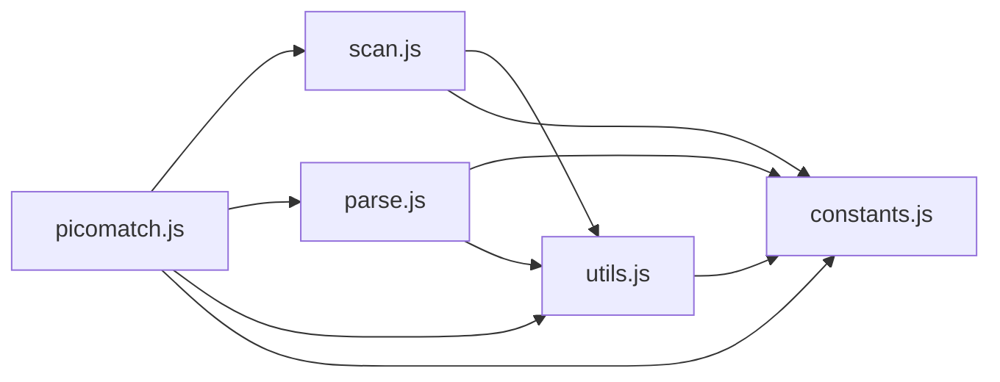

# CodeProof report

Commit: 6bb40679c218cefba5d4e9662408c5fdf699a8bb  |  run-id: 62cbababd7a84e9a  |  mode: smoke

**Publishing rule:** a finding appears under *Verified findings* only if every citation passed L1 and the adversarial verifier confirmed it. This checks provenance and model agreement, not semantic proof. Refuted, uncertain and moderate findings are in rejected.md.

## Summary

| Metric | Value |
|---|---|
| Files / LOC | 5 / 2445 |
| Import edges / cycles | 9 / 0 |
| Files in scanner prompt | 5 / 5 |
| Findings proposed | 5 |
| Rejected at L1 (bad citation) | 1 |
| Verified | 3 |
| Reproduced by execution (L3) | 2 |
| Patch-proven (L4, differential) | 2 |
| Moderate confidence | 1 |
| Refuted | 0 |
| Uncertain | 0 |
| Calls / retries | 16 / 0 |
| Tokens in / out | 113755 / 87597 |
| Cached input tokens | 11260 |
| Cost | $1.5348 |

## Verified findings

### F-001 - high - input-equals-glob shortcut bypasses regex

**Claim:** picomatch.test returns match=true whenever input string equals glob string without running the regex, so a pattern like "[abc]" incorrectly matches the literal input "[abc]".

**Proposed by:** Muse Spark

**Evidence level:** citation-proven + adversarially-confirmed

**Execution check:** inconclusive: reproducer failed L0: controlCode assertion is not tied to a call of an imported symbol; testCode assertion is not tied to a call of an imported symbol; control and trigger must use a different input: no shared symbol is called in both codes

**Citation (from commit, lines 139-153):** picomatch.js
```text
  let match = input === glob;
  let output = (match && format) ? format(input) : input;

  if (match === false) {
    output = format ? format(input) : input;
    match = output === glob;
  }

  if (match === false || opts.capture === true) {
    if (opts.matchBase === true || opts.basename === true) {
      match = picomatch.matchBase(input, regex, options, posix);
    } else {
      match = regex.exec(output);
    }
  }
```

**Verifier (muse-wonder-1.0):** confirm - picomatch.test at picomatch.js:139 sets match=input===glob and at picomatch.js:147 only runs the regex when match is false or capture is true, so input '[abc]' equal to glob '[abc]' returns Boolean(match)=true at picomatch.js:155 without regex execution.

### F-002 - high - tokens assignment uses falsy check for index 0

**Claim:** Last token value is only assigned when prevIndex is truthy, so for inputs with a leading slash where prevIndex is 0 the assignment is skipped and tokens keep an empty value.

**Proposed by:** Muse Spark

**Evidence level:** citation-proven + adversarially-confirmed + **execution-proven (generated test fails on the analyzed commit)**

**Execution check:** reproduced by execution: the control passed 3/3 and the trigger failed 3/3 (see Reproduced by execution)

**Citation (from commit, lines 390-394):** scan.js
```text
    if (opts.tokens && prevIndex && prevIndex + 1 < input.length) {
      tokens[tokens.length - 1].value = value;
      depth(tokens[tokens.length - 1]);
      state.maxDepth += tokens[tokens.length - 1].depth;
    }
```

**Verifier (muse-wonder-1.0):** confirm - The condition at scan.js:390 requires prevIndex to be truthy before assigning the final token at scan.js:391, and scan.js:380-383 sets prevIndex to the slash index i, so a sole leading slash leaves prevIndex as 0 and the final assignment is skipped.

### F-003 - medium - noext clears isGlob

**Claim:** With opts.noext=true both isExtglob and isGlob are cleared, so a plain glob like "*.js" is incorrectly reported as non-glob even though noext should only disable extglobs.

**Proposed by:** Muse Spark

**Evidence level:** citation-proven + adversarially-confirmed + **execution-proven (generated test fails on the analyzed commit)**

**Execution check:** reproduced by execution: the control passed 3/3 and the trigger failed 3/3 (see Reproduced by execution)

**Citation (from commit, lines 301-304):** scan.js
```text
  if (opts.noext === true) {
    isExtglob = false;
    isGlob = false;
  }
```

**Verifier (muse-wonder-1.0):** confirm - The block at scan.js:301-304 unconditionally clears both isExtglob and isGlob when opts.noext is true, and the cleared isGlob is then used for the base/glob split at scan.js:316-324 and reported in state at scan.js:340-352, so non-extglob glob detection such as the bracket case at scan.js:242-243 is also erased.

## Reproduced by execution

For each finding below, the verifier model wrote two standalone files. They run on a `git archive` snapshot of the analyzed commit inside a permission-model sandbox: no network, no writes, 2 s timeout, three runs each.

- **[CONTROL]** uses a clean, normal input and must pass 3/3. It proves the environment and the way the API is called are valid; if it fails, the finding is reported as `control-failed` and the trigger is never run.
- **[TRIGGER]** uses a different input and must fail 3/3 with an assertion error on the analyzed commit.
- **LinkCheck** (Node 26) runs the trigger under the permission model with inspector coverage and requires that the imported symbol actually executed. Without that linkage proof the finding is not reported as execution-proven.


### F-002 - tokens assignment uses falsy check for index 0

**Expected behavior:** scan(input, {tokens:true}) should set the last token's value to the final path segment after the last slash.

**Control (must pass 3/3 on the analyzed commit):**
```js
import assert from 'node:assert/strict';
import scan from './scan.js';
const result = scan('foo/bar', { tokens: true });
assert.equal(result.tokens.length, 2);
assert.equal(result.tokens[0].value, 'foo');
assert.equal(result.tokens[1].value, 'bar');
```

**Trigger (must fail 3/3 with an assertion error on the analyzed commit):**
```js
import assert from 'node:assert/strict';
import scan from './scan.js';
const result = scan('/foo', { tokens: true });
assert.equal(result.tokens.length, 2);
assert.equal(result.tokens[0].value, '');
assert.equal(result.tokens[1].value, 'foo');
```

**LinkCheck:** proven - the imported symbol executed under inspector coverage.

**Runner output (last of 3 attempts):**
```text
'' !== 'foo'

    at file:///tmp/codeproof-repro-hYAg2Y/snapshot/.codeproof-repro.test.mjs:6:8
    at ModuleJob.run (node:internal/modules/esm/module_job:569:25)
    at async node:internal/modules/esm/loader:650:26
    at async asyncRunEntryPointWithESMLoader (node:internal/modules/run_main:101:5) {
  generatedMessage: true,
  code: 'ERR_ASSERTION',
  actual: '',
  expected: 'foo',
  operator: 'strictEqual',
  diff: 'simple'
}

Node.js v26.8.2
```

### F-003 - noext clears isGlob

**Expected behavior:** scan() reports plain glob patterns as isGlob=true (and isExtglob=false); noext should only disable extglob detection, not clear isGlob for plain globs like *.js.

**Control (must pass 3/3 on the analyzed commit):**
```js
import assert from 'node:assert/strict';
import scan from './scan.js';
const result = scan('foo/bar/*.js');
assert.equal(result.isGlob, true);
assert.equal(result.isExtglob, false);
```

**Trigger (must fail 3/3 with an assertion error on the analyzed commit):**
```js
import assert from 'node:assert/strict';
import scan from './scan.js';
const result = scan('*.js', { noext: true });
assert.equal(result.isExtglob, false);
assert.equal(result.isGlob, true);
```

**LinkCheck:** proven - the imported symbol executed under inspector coverage.

**Runner output (last of 3 attempts):**
```text
false !== true

    at file:///tmp/codeproof-repro-9tajkX/snapshot/.codeproof-repro.test.mjs:5:8
    at ModuleJob.run (node:internal/modules/esm/module_job:569:25)
    at async node:internal/modules/esm/loader:650:26
    at async asyncRunEntryPointWithESMLoader (node:internal/modules/run_main:101:5) {
  generatedMessage: true,
  code: 'ERR_ASSERTION',
  actual: false,
  expected: true,
  operator: 'strictEqual',
  diff: 'simple'
}

Node.js v26.8.2
```

## Patch-proven (differential proof)

For each finding below the patcher model proposed a minimal patch to one of the cited files. The patch is applied to a **copy** of the L3 snapshot (the snapshot itself is never mutated) and both phases are re-run: the control must still pass 3/3 and the trigger must now pass 3/3. This is a differential result over the reproduction - it does not claim to fix the root cause, and the repository's own test suite is not run.

### F-002 - tokens assignment uses falsy check for index 0

**Patch rationale:** prevIndex is 0 for a leading slash, so the truthy check skips assigning the last token. Checking explicitly for undefined distinguishes unset from index 0.

```diff
--- a/scan.js
+++ b/scan.js
@@ -390,1 +390,1 @@
-    if (opts.tokens && prevIndex && prevIndex + 1 < input.length) {
+    if (opts.tokens && prevIndex !== undefined && prevIndex + 1 < input.length) {
```

**Differential result:** control passed 3/3, trigger passed 3/3 after the patch. The repository's own test suite was not run; the patch was never written to the analyzed repository.

**Warnings:** replaceBlock contains literals that also appear in the generated test (possible overfitting): 1, 1, 1

### F-003 - noext clears isGlob

**Patch rationale:** noext should only disable extglob detection, not clear isGlob for plain globs like *.js.

```diff
--- a/scan.js
+++ b/scan.js
@@ -303,1 +302,0 @@
-    isGlob = false;
```

**Differential result:** control passed 3/3, trigger passed 3/3 after the patch. The repository's own test suite was not run; the patch was never written to the analyzed repository.

## Architecture

Deterministic facts only: 5 files, 2445 LOC, 9 import edges, 0 cycles. The diagram is generated from the import graph by code, never by the model.



## Limits

- Scan and verify are static: the analyzed code is never executed while the scanner and verifier run. L3 runs only the generated test, on a git-archive snapshot, inside a permission-model sandbox (no network, no writes, 2 s timeout); isolation is process-level, not OS-level.
- No completeness claim; this report shows what passed the gate, not everything that exists in the repository.
- Only direct correctness defects; omission, security and style findings are out of scope for this milestone.
- The L1 gate proves that a citation exists in the commit; the semantic match is judged by the verifier model and presented as such.

