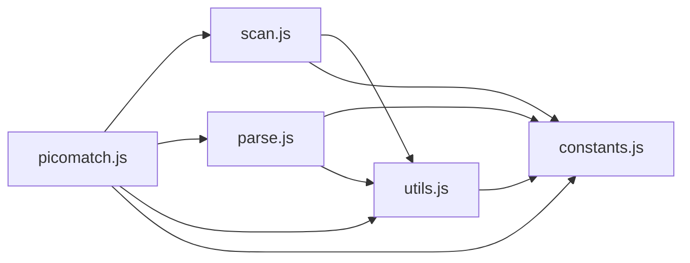

# CodeProof report

Commit: 6bb40679c218cefba5d4e9662408c5fdf699a8bb  |  run-id: 62cbababd7a84e9a  |  mode: smoke

**Publishing rule:** a finding appears under *Verified findings* only if every citation passed L1 and the adversarial verifier confirmed it. This checks provenance and model agreement, not semantic proof. Refuted, uncertain and moderate findings are in rejected.md.

## Summary

| Metric | Value |
|---|---|
| Files / LOC | 5 / 2445 |
| Import edges / cycles | 9 / 0 |
| Files in scanner prompt | 5 / 5 |
| Findings proposed | 4 |
| Rejected at L1 (bad citation) | 0 |
| Verified | 2 |
| Reproduced by execution (L3) | 1 |
| Patch-proven (L4, differential) | 1 |
| Moderate confidence | 0 |
| Refuted | 0 |
| Uncertain | 2 |
| Calls / retries | 11 / 0 |
| Tokens in / out | 98360 / 69709 |
| Cached input tokens | 63490 |
| Cost | $1.0231 |

## Verified findings

### F-002 - high - noext incorrectly clears isGlob

**Claim:** With noext:true the scanner clears isGlob for all patterns, so a pattern like *.js that still contains a star is incorrectly reported as non-glob.

**Proposed by:** Muse Spark

**Evidence level:** citation-proven + adversarially-confirmed + **execution-proven (generated test fails on the analyzed commit)**

**Execution check:** reproduced by execution: the control passed 3/3 and the trigger failed 3/3 (see Reproduced by execution)

**Citation (from commit, lines 301-304):** scan.js
```text
  if (opts.noext === true) {
    isExtglob = false;
    isGlob = false;
  }
```

**Verifier (muse-wonder-1.0):** confirm - The unconditional block at scan.js:301-304 sets isGlob=false whenever opts.noext is true, and that cleared value is reported in the returned state at scan.js:348, so a plain star pattern such as *.js loses its glob status.

### F-004 - low - basename returns undefined for empty path

**Claim:** basename("") returns undefined instead of a string because segs[segs.length-2] is out of bounds when the split yields a single empty segment.

**Proposed by:** Muse Spark

**Evidence level:** citation-proven + adversarially-confirmed

**Execution check:** inconclusive: reproducer failed L0: controlCode assertion is not tied to a call of an imported symbol; testCode assertion is not tied to a call of an imported symbol; control and trigger must use a different input: no shared symbol is called in both codes

**Citation (from commit, lines 63-72):** utils.js
```text
exports.basename = (path, { windows } = {}) => {
  const segs = path.split(windows ? /[\\/]/ : '/');
  const last = segs[segs.length - 1];

  if (last === '') {
    return segs[segs.length - 2];
  }

  return last;
};
```

**Verifier (muse-wonder-1.0):** confirm - Confirmed: at utils.js:63-68, basename splits the path and returns segs[segs.length-2] when last is '', so for '' the split is [''] and segs[-1] is undefined.

## Reproduced by execution

For each finding below, the verifier model wrote two standalone files. They run on a `git archive` snapshot of the analyzed commit inside a permission-model sandbox: no network, no writes, 2 s timeout, three runs each.

- **[CONTROL]** uses a clean, normal input and must pass 3/3. It proves the environment and the way the API is called are valid; if it fails, the finding is reported as `control-failed` and the trigger is never run.
- **[TRIGGER]** uses a different input and must fail 3/3 with an assertion error on the analyzed commit.
- **LinkCheck** (Node 26) runs the trigger under the permission model with inspector coverage and requires that the imported symbol actually executed. Without that linkage proof the finding is not reported as execution-proven.


### F-002 - noext incorrectly clears isGlob

**Expected behavior:** scan reports a pattern containing '*' as a glob (isGlob true) even when noext disables extglobs

**Control (must pass 3/3 on the analyzed commit):**
```js
import assert from 'node:assert/strict';
import scan from './scan.js';
const result = scan('foo/*.js');
assert.equal(result.isGlob, true);
assert.equal(result.glob, '*.js');
```

**Trigger (must fail 3/3 with an assertion error on the analyzed commit):**
```js
import assert from 'node:assert/strict';
import scan from './scan.js';
const result = scan('bar/*.txt', { noext: true });
assert.equal(result.isGlob, true);
assert.equal(result.glob, '*.txt');
```

**LinkCheck:** proven - the imported symbol executed under inspector coverage.

**Runner output (last of 3 attempts):**
```text
false !== true

    at file:///tmp/codeproof-repro-3CBSZD/snapshot/.codeproof-repro.test.mjs:4:8
    at ModuleJob.run (node:internal/modules/esm/module_job:569:25)
    at async node:internal/modules/esm/loader:650:26
    at async asyncRunEntryPointWithESMLoader (node:internal/modules/run_main:101:5) {
  generatedMessage: true,
  code: 'ERR_ASSERTION',
  actual: false,
  expected: true,
  operator: 'strictEqual',
  diff: 'simple'
}

Node.js v26.8.2
```

## Patch-proven (differential proof)

For each finding below the patcher model proposed a minimal patch to one of the cited files. The patch is applied to a **copy** of the L3 snapshot (the snapshot itself is never mutated) and both phases are re-run: the control must still pass 3/3 and the trigger must now pass 3/3. This is a differential result over the reproduction - it does not claim to fix the root cause, and the repository's own test suite is not run.

### F-002 - noext incorrectly clears isGlob

**Patch rationale:** noext should only disable extglob detection; clearing isGlob also misclassifies patterns containing '*' and prevents glob extraction.

```diff
--- a/scan.js
+++ b/scan.js
@@ -303,1 +302,0 @@
-    isGlob = false;
```

**Differential result:** control passed 3/3, trigger passed 3/3 after the patch. The repository's own test suite was not run; the patch was never written to the analyzed repository.

## Architecture

Deterministic facts only: 5 files, 2445 LOC, 9 import edges, 0 cycles. The diagram is generated from the import graph by code, never by the model.



## Limits

- Scan and verify are static: the analyzed code is never executed while the scanner and verifier run. L3 runs only the generated test, on a git-archive snapshot, inside a permission-model sandbox (no network, no writes, 2 s timeout); isolation is process-level, not OS-level.
- No completeness claim; this report shows what passed the gate, not everything that exists in the repository.
- Only direct correctness defects; omission, security and style findings are out of scope for this milestone.
- The L1 gate proves that a citation exists in the commit; the semantic match is judged by the verifier model and presented as such.

