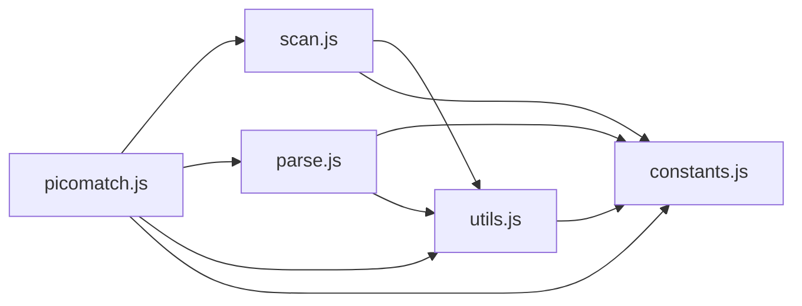

# CodeProof report

Commit: 6bb40679c218cefba5d4e9662408c5fdf699a8bb  |  run-id: 62cbababd7a84e9a  |  mode: smoke

**Publishing rule:** a finding appears under *Verified findings* only if every citation passed L1 and the adversarial verifier confirmed it. This checks provenance and model agreement, not semantic proof. Refuted, uncertain and moderate findings are in rejected.md.

## Summary

| Metric | Value |
|---|---|
| Files / LOC | 5 / 2445 |
| Import edges / cycles | 9 / 0 |
| Files in scanner prompt | 5 / 5 |
| Findings proposed | 1 |
| Rejected at L1 (bad citation) | 0 |
| Verified | 1 |
| Reproduced by execution (L3) | 1 |
| Moderate confidence | 0 |
| Refuted | 0 |
| Uncertain | 0 |
| Calls / retries | 5 / 0 |
| Tokens in / out | 43178 / 32723 |
| Cached input tokens | 8040 |
| Cost | $0.5252 |

## Verified findings

### F-001 - medium - Falsy zero check skips last token update for leading slash

**Claim:** prevIndex is tested for truthiness, so when the first slash is at index 0 (leading-slash input like "/foo") prevIndex becomes 0 and is treated as falsy. The final tokens update is skipped, leaving the last token value as '' and maxDepth under-counted.

**Proposed by:** Muse Spark

**Evidence level:** citation-proven + adversarially-confirmed + **execution-proven (generated test fails on the analyzed commit)**

**Execution check:** reproduced by execution: the control passed 3/3 and the trigger failed 3/3 (see Reproduced by execution)

**Citation (from commit, lines 390-394):** scan.js
```text
    if (opts.tokens && prevIndex && prevIndex + 1 < input.length) {
      tokens[tokens.length - 1].value = value;
      depth(tokens[tokens.length - 1]);
      state.maxDepth += tokens[tokens.length - 1].depth;
    }
```

**Verifier (muse-wonder-1.0):** confirm - At scan.js:382 prevIndex is set to the slash index i, so for "/foo" it becomes 0, and the guard at scan.js:390 tests prevIndex for truthiness, causing the last-token assignment and depth accounting at scan.js:391-393 to be skipped.

## Reproduced by execution

For each finding below, the verifier model wrote two standalone files. They run on a `git archive` snapshot of the analyzed commit inside a permission-model sandbox: no network, no writes, 2 s timeout, three runs each.

- **[CONTROL]** uses a clean, normal input and must pass 3/3. It proves the environment and the way the API is called are valid; if it fails, the finding is reported as `control-failed` and the trigger is never run.
- **[TRIGGER]** uses a different input and must fail 3/3 with an assertion error on the analyzed commit.
- **LinkCheck** (Node 26) runs the trigger under the permission model with inspector coverage and requires that the imported symbol actually executed. Without that linkage proof the finding is not reported as execution-proven.


### F-001 - Falsy zero check skips last token update for leading slash

**Expected behavior:** scan with tokens returns the final path segment in the last token and counts its depth in maxDepth, including for a leading-slash pattern.

**Control (must pass 3/3 on the analyzed commit):**
```js
import assert from 'node:assert/strict';
import scan from './scan.js';

const result = scan('foo/bar', { tokens: true });
assert.equal(result.tokens.length, 2);
assert.equal(result.tokens[result.tokens.length - 1].value, 'bar');
assert.equal(result.maxDepth, 2);
assert.deepEqual(result.parts, ['foo', 'bar']);
```

**Trigger (must fail 3/3 with an assertion error on the analyzed commit):**
```js
import assert from 'node:assert/strict';
import scan from './scan.js';

const result = scan('/foo', { tokens: true });
assert.equal(result.tokens.length, 2);
assert.equal(result.tokens[result.tokens.length - 1].value, 'foo');
assert.equal(result.maxDepth, 2);
assert.deepEqual(result.parts, ['', 'foo']);
```

**LinkCheck:** proven - the imported symbol executed under inspector coverage.

**Runner output (last of 3 attempts):**
```text
'' !== 'foo'

    at file:///tmp/codeproof-repro-a971WW/snapshot/.codeproof-repro.test.mjs:6:8
    at ModuleJob.run (node:internal/modules/esm/module_job:569:25)
    at async node:internal/modules/esm/loader:650:26
    at async asyncRunEntryPointWithESMLoader (node:internal/modules/run_main:101:5) {
  generatedMessage: true,
  code: 'ERR_ASSERTION',
  actual: '',
  expected: 'foo',
  operator: 'strictEqual',
  diff: 'simple'
}

Node.js v26.8.2
```

## Architecture

Deterministic facts only: 5 files, 2445 LOC, 9 import edges, 0 cycles. The diagram is generated from the import graph by code, never by the model.



## Limits

- Scan and verify are static: the analyzed code is never executed while the scanner and verifier run. L3 runs only the generated test, on a git-archive snapshot, inside a permission-model sandbox (no network, no writes, 2 s timeout); isolation is process-level, not OS-level.
- No completeness claim; this report shows what passed the gate, not everything that exists in the repository.
- Only direct correctness defects; omission, security and style findings are out of scope for this milestone.
- The L1 gate proves that a citation exists in the commit; the semantic match is judged by the verifier model and presented as such.

