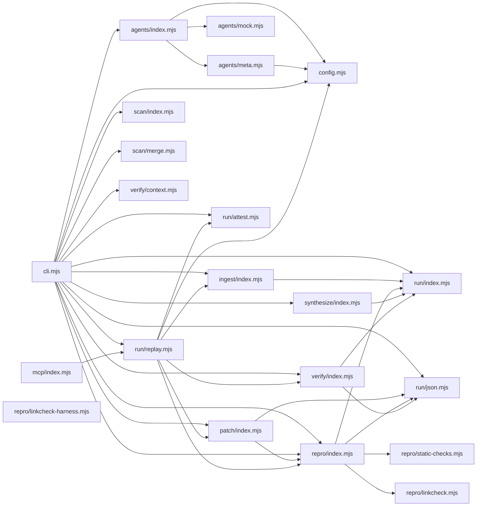

# CodeProof report

Commit: 25c2a26c1c00666886df0b9a8c0a29be015a9635  |  run-id: a5e5c1c9868a5e4f  |  mode: smoke

**Publishing rule:** a finding appears under *Verified findings* only if every citation passed L1 and the adversarial verifier confirmed it. This checks provenance and model agreement, not semantic proof. Refuted, uncertain and moderate findings are in rejected.md.

## Summary

| Metric | Value |
|---|---|
| Files / LOC | 21 / 4221 |
| Import edges / cycles | 36 / 0 |
| Files in scanner prompt | 21 / 21 |
| Findings proposed | 3 |
| Rejected at L1 (bad citation) | 0 |
| Verified | 3 |
| Reproduced by execution (L3) | 1 |
| Patch-proven (L4, differential) | 1 |
| Moderate confidence | 0 |
| Refuted | 0 |
| Uncertain | 0 |
| Calls / retries | 9 / 0 |
| Tokens in / out | 107092 / 43883 |
| Cached input tokens | 5152 |
| Cost | $0.8968 |

## Verified findings

### F-001 - high - unifiedDiff emits undefined lines for prefix append

**Claim:** unifiedDiff does not handle append-only changes: when before is a prefix of after, start is -1 with different lengths so it does not return early and then indexes beforeLines[-1]/afterLines[-1] producing undefined diff lines.

**Proposed by:** Muse Spark

**Evidence level:** citation-proven + adversarially-confirmed + **execution-proven (generated test fails on the analyzed commit)**

**Execution check:** reproduced by execution: the control passed 3/3 and the trigger failed 3/3 (see Reproduced by execution)

**Citation (from commit, lines 152-159):** patch/index.mjs
```text
  const start = beforeLines.findIndex(function (line, index) { return line !== afterLines[index]; });
  if (start === -1 && beforeLines.length === afterLines.length) return "";
  let beforeEnd = beforeLines.length;
  let afterEnd = afterLines.length;
  while (beforeEnd > start && afterEnd > start && beforeLines[beforeEnd - 1] === afterLines[afterEnd - 1]) { beforeEnd -= 1; afterEnd -= 1; }
  const lines = ["--- a/" + label, "+++ b/" + label, "@@ -" + (start + 1) + "," + Math.max(1, beforeEnd - start) + " +" + (start + 1) + "," + Math.max(1, afterEnd - start) + " @@"];
  for (let index = start; index < beforeEnd; index += 1) lines.push("-" + beforeLines[index]);
  for (let index = start; index < afterEnd; index += 1) lines.push("+" + afterLines[index]);
```

**Verifier (muse-wonder-1.0):** confirm - Confirmed at patch/index.mjs:152-159: when beforeLines is a line-prefix of afterLines findIndex returns -1, the equality guard at patch/index.mjs:153 does not return because lengths differ, the suffix loop cannot remove the -1 start, and both output loops begin at index -1, pushing '-'+beforeLines[-1] and '+'+afterLines[-1] i.e. '-undefined'/'+undefined'.

### F-002 - high - scanner-secondary estimate vs execution model mismatch

**Claim:** Hard-budget estimate and actual execution use different fallback models for scanner-secondary: estimate falls back to scannerModel while the agent is constructed with verifierModel, so the preflight prices a different model than is called.

**Proposed by:** Muse Spark

**Evidence level:** citation-proven + adversarially-confirmed

**Execution check:** inconclusive: reproducer failed L0: control and trigger must use a different input: control and trigger call the shared symbol(s) with identical arguments

**Citation (from commit, lines 40-43):** agents/index.mjs
```text
  function modelForRole(role) {
    if (role === "scanner") return options.scannerModel;
    if (role === "scanner-secondary") return options.secondaryScannerModel || options.scannerModel;
    if (role === "verifier-secondary") return options.secondaryVerifierModel || options.scannerModel;
```
**Citation (from commit, lines 118-122):** agents/index.mjs
```text
    "scanner-secondary": createMetaAgent({
      apiKey: options.apiKey,
      baseUrl: options.baseUrl,
      model: options.secondaryScannerModel || options.verifierModel,
      maxRetries: options.maxRetries,
```

**Verifier (muse-wonder-1.0):** confirm - Confirmed: agents/index.mjs:42 estimates scanner-secondary as secondaryScannerModel || scannerModel, while agents/index.mjs:121 constructs that agent as secondaryScannerModel || verifierModel, and agents/index.mjs:141-145 uses modelForRole for the hard-budget preflight before dispatching to byRole.

### F-003 - medium - secondary and patcher calls aggregated as verifier

**Claim:** Usage aggregation buckets every non-scanner/non-repro role into verifier, so scanner-secondary, verifier-secondary and patcher calls are misreported as verifier calls with the wrong model bucket.

**Proposed by:** Muse Spark

**Evidence level:** citation-proven + adversarially-confirmed

**Execution check:** unavailable: No exported API exposes the usage-aggregation logic; it is embedded in cli.mjs main() and only reachable through a full CLI run.

**Citation (from commit, lines 565-566):** cli.mjs
```text
  for (const call of agents.callLog) {
    const role = call.role === "scanner" ? "scanner-correctness" : call.role === "repro" ? "repro" : "verifier";
```

**Verifier (muse-wonder-1.0):** confirm - The ternary at cli.mjs:566 maps only scanner and repro explicitly and defaults every other role to verifier, while agents/index.mjs:110-133 defines distinct patcher, scanner-secondary, and verifier-secondary agents with different model fallbacks, and cli.mjs:568 fixes the bucket model from the first aggregated call, so those calls are misreported as verifier usage.

## Reproduced by execution

For each finding below, the verifier model wrote two standalone files. They run on a `git archive` snapshot of the analyzed commit inside a permission-model sandbox: no network, no writes, 2 s timeout, three runs each.

- **[CONTROL]** uses a clean, normal input and must pass 3/3. It proves the environment and the way the API is called are valid; if it fails, the finding is reported as `control-failed` and the trigger is never run.
- **[TRIGGER]** uses a different input and must fail 3/3 with an assertion error on the analyzed commit.
- **LinkCheck** (Node 26) runs the trigger under the permission model with inspector coverage and requires that the imported symbol actually executed. Without that linkage proof the finding is not reported as execution-proven.


### F-001 - unifiedDiff emits undefined lines for prefix append

**Expected behavior:** unifiedDiff for a changed line emits -beta/+gamma with no undefined or unchanged lines; for an append-only change where before is a prefix of after it should emit only +gamma with no undefined or removed/unchanged lines.

**Control (must pass 3/3 on the analyzed commit):**
```js
import assert from "node:assert/strict";
import { unifiedDiff } from "./patch/index.mjs";
const diff = unifiedDiff("alpha\nbeta", "alpha\ngamma", { label: "sample" });
assert.ok(diff.includes("-beta"));
assert.ok(diff.includes("+gamma"));
assert.equal(diff.includes("undefined"), false);
assert.equal(diff.includes("-alpha"), false);
assert.equal(diff.includes("+alpha"), false);
```

**Trigger (must fail 3/3 with an assertion error on the analyzed commit):**
```js
import assert from "node:assert/strict";
import { unifiedDiff } from "./patch/index.mjs";
const diff = unifiedDiff("alpha\nbeta", "alpha\nbeta\ngamma", { label: "sample" });
assert.equal(diff.includes("undefined"), false);
assert.ok(diff.includes("+gamma"));
assert.equal(diff.includes("-alpha"), false);
assert.equal(diff.includes("-beta"), false);
assert.equal(diff.includes("+alpha"), false);
assert.equal(diff.includes("+beta"), false);
```

**LinkCheck:** proven - the imported symbol executed under inspector coverage.

**Runner output (last of 3 attempts):**
```text
true !== false

    at file:///tmp/codeproof-repro-hJf8Lj/snapshot/.codeproof-repro.test.mjs:4:8
    at ModuleJob.run (node:internal/modules/esm/module_job:569:25)
    at async node:internal/modules/esm/loader:650:26
    at async asyncRunEntryPointWithESMLoader (node:internal/modules/run_main:101:5) {
  generatedMessage: true,
  code: 'ERR_ASSERTION',
  actual: true,
  expected: false,
  operator: 'strictEqual',
  diff: 'simple'
}

Node.js v26.8.2
```

## Patch-proven (differential proof)

For each finding below the patcher model proposed a minimal patch to one of the cited files. The patch is applied to a **copy** of the L3 snapshot (the snapshot itself is never mutated) and both phases are re-run: the control must still pass 3/3 and the trigger must now pass 3/3. This is a differential result over the reproduction - it does not claim to fix the root cause, and the repository's own test suite is not run.

### F-001 - unifiedDiff emits undefined lines for prefix append

**Patch rationale:** When before is a prefix of after, findIndex returns -1 but lengths differ so the early return is skipped, causing indexing at -1. Normalizing -1 to the common prefix length makes the diff emit only the appended lines.

```diff
--- a/patch/index.mjs
+++ b/patch/index.mjs
@@ -152,2 +152,3 @@
-  const start = beforeLines.findIndex(function (line, index) { return line !== afterLines[index]; });
-  if (start === -1 && beforeLines.length === afterLines.length) return "";
+  let start = beforeLines.findIndex(function (line, index) { return line !== afterLines[index]; });
+  if (start === -1 && beforeLines.length === afterLines.length) return "";
+  if (start === -1) start = Math.min(beforeLines.length, afterLines.length);
```

**Differential result:** control passed 3/3, trigger passed 3/3 after the patch. The repository's own test suite was not run; the patch was never written to the analyzed repository.

## Architecture

Deterministic facts only: 21 files, 4221 LOC, 36 import edges, 0 cycles. The diagram is generated from the import graph by code, never by the model.



## Limits

- Scan and verify are static: the analyzed code is never executed while the scanner and verifier run. L3 runs only the generated test, on a git-archive snapshot, inside a permission-model sandbox (no network, no writes, 2 s timeout); isolation is process-level, not OS-level.
- No completeness claim; this report shows what passed the gate, not everything that exists in the repository.
- Only direct correctness defects; omission, security and style findings are out of scope for this milestone.
- The L1 gate proves that a citation exists in the commit; the semantic match is judged by the verifier model and presented as such.

