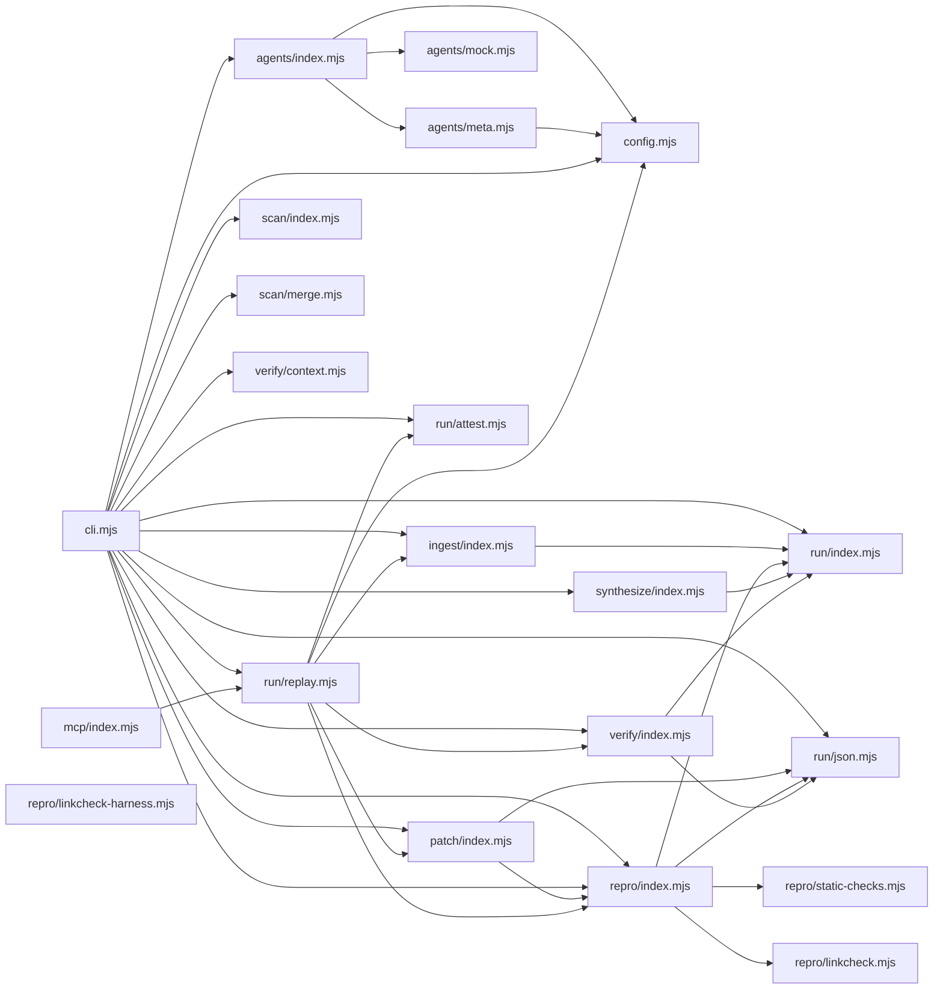

# CodeProof report

Commit: 1e5f577ed8b3a642fb9594385b614309aca017f4  |  run-id: 87bfeb3ea3be6e85  |  mode: smoke

**Publishing rule:** a finding appears under *Verified findings* only if every citation passed L1 and the adversarial verifier confirmed it. This checks provenance and model agreement, not semantic proof. Refuted, uncertain and moderate findings are in rejected.md.

## Summary

| Metric | Value |
|---|---|
| Files / LOC | 21 / 4221 |
| Import edges / cycles | 36 / 0 |
| Files in scanner prompt | 21 / 21 |
| Findings proposed | 11 |
| Rejected at L1 (bad citation) | 2 |
| Verified | 9 |
| Reproduced by execution (L3) | 3 |
| Patch-proven (L4, differential) | 2 |
| Moderate confidence | 0 |
| Refuted | 0 |
| Uncertain | 0 |
| Calls / retries | 32 / 0 |
| Tokens in / out | 192182 / 149040 |
| Cached input tokens | 13656 |
| Cost | $2.2573 |

## Verified findings

### F-001 - medium - Secondary scanner usage counted as verifier

**Claim:** Secondary scanner calls use role scanner-secondary but the usage aggregation only maps exact scanner to scanner-correctness, so all secondary scanner tokens/calls are misattributed to verifier.

**Proposed by:** Muse Spark

**Evidence level:** citation-proven + adversarially-confirmed

**Execution check:** unavailable: Bug is in unexported inline logic in cli.mjs main(); no exported API exposes secondary-scanner usage aggregation.

**Citation (from commit, lines 336-336):** cli.mjs
```text
        const secondary = await runScanner("scanner-secondary", secondaryLabel, scanMessages, scanFormat);
```
**Citation (from commit, lines 232-232):** cli.mjs
```text
      let call = await agents.complete({ role: role, messages: messages, responseFormat: format, temperature: config.temperature, maxTokens: config.scannerMaxTokens });
```
**Citation (from commit, lines 566-566):** cli.mjs
```text
    const role = call.role === "scanner" ? "scanner-correctness" : call.role === "repro" ? "repro" : "verifier";
```

**Verifier (muse-wonder-1.0):** confirm - Confirmed: cli.mjs:336 runs the secondary scanner with role scanner-secondary, agents/index.mjs:55 preserves that exact role in callLog, and cli.mjs:566 maps only exact scanner to scanner-correctness with every other role falling through to verifier.

### F-003 - high - scanner-secondary fallback model differs between estimate and execution

**Claim:** modelForRole falls back to scannerModel for scanner-secondary while the actual scanner-secondary agent is constructed with verifierModel, so the hard-budget estimate prices a different model than the one executed.

**Proposed by:** Muse Spark

**Evidence level:** citation-proven + adversarially-confirmed + **execution-proven (generated test fails on the analyzed commit)**

**Execution check:** reproduced by execution: the control passed 3/3 and the trigger failed 3/3 (see Reproduced by execution)

**Citation (from commit, lines 42-42):** agents/index.mjs
```text
    if (role === "scanner-secondary") return options.secondaryScannerModel || options.scannerModel;
```
**Citation (from commit, lines 121-121):** agents/index.mjs
```text
      model: options.secondaryScannerModel || options.verifierModel,
```
**Citation (from commit, lines 140-145):** agents/index.mjs
```text
      if (options.hardBudget) {
        const model = modelForRole(request.role);
        const estimate = estimateRequestCost(model, request);
        if (!budget.canAfford(estimate)) return Promise.reject(hardBudgetError(estimate, model));
      }
      return byRole[request.role](request).then(function (result) { return record(request.role, result); });
```

**Verifier (muse-wonder-1.0):** confirm - Confirmed: agents/index.mjs:42 makes modelForRole fall back to options.scannerModel for scanner-secondary, while agents/index.mjs:121 constructs that agent with options.secondaryScannerModel || options.verifierModel, and agents/index.mjs:140-143 uses modelForRole for the hard-budget estimate, so when secondaryScannerModel is unset the estimate prices a different model than execution.

### F-004 - high - from-scan uses semicolon terminator crossing ASI boundaries

**Claim:** extractSpecifiers scans forward for 'from' until ';', so when statements omit semicolons (ASI) the scan crosses statement boundaries and attributes a later import's specifier to an earlier import/export, yielding false or duplicate edges.

**Proposed by:** Muse Spark

**Evidence level:** citation-proven + adversarially-confirmed

**Execution check:** inconclusive: reproducer failed L0: controlCode: forbidden file write; controlCode: forbidden ambient runtime module; controlCode: forbidden process access; testCode: forbidden file write; testCode: forbidden ambient runtime module; testCode: forbidden process access

**Citation (from commit, lines 91-96):** ingest/index.mjs
```text
      for (let j = i + 1; j < tokens.length && tokens[j].value !== ";"; j++) {
        if (tokens[j].value === "from" && tokens[j + 1]?.type === "string") {
          out.push(tokens[j + 1].value);
          break;
        }
      }
```

**Verifier (muse-wonder-1.0):** confirm - The scan at ingest/index.mjs:91 stops only on ';' and pushes the first following 'from' string at ingest/index.mjs:92-94, while the tokenizer discards newlines as whitespace at ingest/index.mjs:48, so a semicolon-less import/export can capture a later import's specifier and push it again when that later import is visited.

### F-005 - high - scanner input separator bytes omitted from budget

**Claim:** buildScannerInput budgets only block.length but joins with "\n\n", so chars omits separators and text.length can exceed the maxChars limit.

**Proposed by:** Muse Spark

**Evidence level:** citation-proven + adversarially-confirmed + **execution-proven (generated test fails on the analyzed commit)**

**Execution check:** reproduced by execution: the control passed 3/3 and the trigger failed 3/3 (see Reproduced by execution)

**Citation (from commit, lines 227-237):** ingest/index.mjs
```text
    if (used + block.length > limit) break;
    parts.push(block);
    used += block.length;
    included.push(file.path);
  }
  return {
    text: parts.join("\n\n"),
    included: included,
    filesInPrompt: included.length,
    filesTotal: result.files.length,
    chars: used,
```

**Verifier (muse-wonder-1.0):** confirm - Confirmed at ingest/index.mjs:227-233: the loop budgets only block.length into used and returns chars: used, while text is parts.join("\n\n"), adding 2*(parts.length-1) unbudgeted characters so text.length can exceed the limit.

### F-007 - low - numbered scanner output adds extra line for trailing newline

**Claim:** ingest loc excludes a trailing newline but buildScannerInput numbers source.split("\n") including the trailing empty string, so a file ending with newline emits loc+1 numbered lines while the header claims loc lines.

**Proposed by:** Muse Spark

**Evidence level:** citation-proven + adversarially-confirmed

**Execution check:** inconclusive: reproducer failed L0: controlCode assertion is not tied to a call of an imported symbol; testCode assertion is not tied to a call of an imported symbol; control and trigger must use a different input: control and trigger call the shared symbol(s) with identical arguments

**Citation (from commit, lines 175-175):** ingest/index.mjs
```text
    const lineCount = source === "" ? 0 : source.split("\n").length - (source.endsWith("\n") ? 1 : 0);
```
**Citation (from commit, lines 223-226):** ingest/index.mjs
```text
    const numbered = source.split("\n").map(function (line, index) {
      return String(index + 1) + " | " + line;
    }).join("\n");
    const block = "### " + file.path + " (" + file.loc + " lines)\n" + numbered;
```

**Verifier (muse-wonder-1.0):** confirm - Confirmed: ingest/index.mjs:175 subtracts one for a trailing newline when computing loc, while ingest/index.mjs:223-226 numbers every element of source.split("\n") including the trailing empty string and labels the block with file.loc, so a newline-terminated file gets loc+1 numbered lines.

### F-008 - high - unifiedDiff mishandles prefix-only changes with start -1

**Claim:** When before is a prefix of after (append-only change) findIndex returns -1, start is left as -1, so the loops start at -1 pushing '-undefined'/'+undefined' and the hunk header uses line 0.

**Proposed by:** Muse Spark

**Evidence level:** citation-proven + adversarially-confirmed + **execution-proven (generated test fails on the analyzed commit)**

**Execution check:** reproduced by execution: the control passed 3/3 and the trigger failed 3/3 (see Reproduced by execution)

**Citation (from commit, lines 152-159):** patch/index.mjs
```text
  const start = beforeLines.findIndex(function (line, index) { return line !== afterLines[index]; });
  if (start === -1 && beforeLines.length === afterLines.length) return "";
  let beforeEnd = beforeLines.length;
  let afterEnd = afterLines.length;
  while (beforeEnd > start && afterEnd > start && beforeLines[beforeEnd - 1] === afterLines[afterEnd - 1]) { beforeEnd -= 1; afterEnd -= 1; }
  const lines = ["--- a/" + label, "+++ b/" + label, "@@ -" + (start + 1) + "," + Math.max(1, beforeEnd - start) + " +" + (start + 1) + "," + Math.max(1, afterEnd - start) + " @@"];
  for (let index = start; index < beforeEnd; index += 1) lines.push("-" + beforeLines[index]);
  for (let index = start; index < afterEnd; index += 1) lines.push("+" + afterLines[index]);
```

**Verifier (muse-wonder-1.0):** confirm - At patch/index.mjs:152-159, findIndex over beforeLines returns -1 when every before line matches the corresponding after line, the guard at patch/index.mjs:153 only returns for equal lengths, and no later code corrects start, so the header at patch/index.mjs:157 uses start+1=0 and the loops at patch/index.mjs:158-159 begin at index -1, producing '-undefined'/'+undefined'.

### F-009 - high - applyPatchToSnapshot uses String.replace with unescaped $ patterns

**Claim:** String.replace with a string replacement interprets $&, $', $`, $n sequences, so replaceBlock containing $ (e.g. template literals) is not inserted literally and the patched file is corrupted.

**Proposed by:** Muse Spark

**Evidence level:** citation-proven + adversarially-confirmed

**Execution check:** inconclusive: reproducer failed L0: unsupported response must not include testCode; unsupported response must not include controlCode; unsupportedReason is too short

**Citation (from commit, lines 138-145):** patch/index.mjs
```text
export function applyPatchToSnapshot(options) {
  const path = join(options.snapshotDir, options.targetFile);
  const source = readFileSync(path, "utf8");
  const occurrences = countOccurrences(source, options.searchBlock);
  if (occurrences !== 1) throw new Error("searchBlock must occur exactly once in " + options.targetFile + " (found " + occurrences + ")");
  const patched = source.replace(options.searchBlock, options.replaceBlock);
  writeFileSync(path, patched);
  return { before: source, after: patched };
```

**Verifier (muse-wonder-1.0):** confirm - The cited code at patch/index.mjs:143 passes options.replaceBlock directly as the string replacement to source.replace(options.searchBlock, options.replaceBlock), so $$, $&, $`, and $' sequences in replaceBlock are substituted rather than inserted literally, with no function replacer or escaping in patch/index.mjs:138-145.

### F-010 - low - attemptPatch unsupported early return skips durationMs

**Claim:** attemptPatch sets durationMs only after the try/catch, but the unsupported branch returns early inside try, so unsupported results always keep the initial durationMs 0.

**Proposed by:** Muse Spark

**Evidence level:** citation-proven + adversarially-confirmed

**Execution check:** inconclusive: reproducer failed L0: control and trigger must use a different input: control and trigger call the shared symbol(s) with identical arguments

**Citation (from commit, lines 220-225):** patch/index.mjs
```text
    if (parsed.kind === "unsupported") {
      const checked = validatePatchL0(parsed, { finding: finding });
      if (!checked.ok) throw new Error("patcher failed L0: " + checked.errors.join("; "));
      result.status = "unsupported";
      result.reason = parsed.unsupportedReason;
      return result;
```
**Citation (from commit, lines 251-257):** patch/index.mjs
```text
  } catch (error) {
    if (error && error.code === "BUDGET_EXCEEDED") throw error;
    result.status = "rejected";
    result.reason = error.message;
  }
  result.durationMs = Date.now() - started;
  return result;
```

**Verifier (muse-wonder-1.0):** confirm - Confirmed: result is initialized with durationMs 0 at patch/index.mjs:205, the unsupported branch returns it directly at patch/index.mjs:225, and the only durationMs assignment is after the try/catch at patch/index.mjs:256, so that path skips it.

### F-011 - high - Unhandled readFileSync throw in checkCitation

**Claim:** checkCitation calls readFileSync without try/catch, so a manifest-listed but missing/unreadable file throws instead of returning {passed:false}.

**Proposed by:** Muse Spark

**Evidence level:** citation-proven + adversarially-confirmed

**Execution check:** inconclusive: reproducer failed L0: controlCode: forbidden ambient runtime module; testCode assertion is not tied to a call of an imported symbol

**Citation (from commit, lines 200-204):** verify/index.mjs
```text
  const committed = repo.commit ? readFileAtCommit(repo.root, repo.commit, file) : null;
  if (repo.commit && committed === null && gitPrefix(repo.root) !== null) {
    return { passed: false, reason: "path is not present in the analyzed commit: " + file };
  }
  const source = committed === null ? readFileSync(join(repo.root, file), "utf8") : committed;
```

**Verifier (muse-wonder-1.0):** confirm - checkCitation at verify/index.mjs:186-242 contains no try/catch, and at verify/index.mjs:204 it falls back to readFileSync(join(repo.root, file), "utf8") when committed is null after only the manifest check at verify/index.mjs:192, so a manifest-listed but missing/unreadable file will throw instead of returning {passed:false}.

## Reproduced by execution

For each finding below, the verifier model wrote two standalone files. They run on a `git archive` snapshot of the analyzed commit inside a permission-model sandbox: no network, no writes, 2 s timeout, three runs each.

- **[CONTROL]** uses a clean, normal input and must pass 3/3. It proves the environment and the way the API is called are valid; if it fails, the finding is reported as `control-failed` and the trigger is never run.
- **[TRIGGER]** uses a different input and must fail 3/3 with an assertion error on the analyzed commit.
- **LinkCheck** (Node 26) runs the trigger under the permission model with inspector coverage and requires that the imported symbol actually executed. Without that linkage proof the finding is not reported as execution-proven.


### F-003 - scanner-secondary fallback model differs between estimate and execution

**Expected behavior:** For scanner-secondary, the hard-budget estimate must price the model that will actually execute. With secondaryScannerModel set, both estimate and execution use it; without it, execution falls back to verifierModel (agents/index.mjs:121), so the estimate/error must name verifierModel, not scannerModel.

**Control (must pass 3/3 on the analyzed commit):**
```js
import assert from "node:assert/strict";
import { createAgents } from "./agents/index.mjs";
const budget = { spentUsd: 0, limitUsd: 1, exceeded: false, canAfford: () => false, charge: () => {} };
const agents = createAgents({
  apiKey: "k",
  baseUrl: "https://example.invalid",
  scannerModel: "control-scanner-model",
  verifierModel: "control-verifier-model",
  secondaryScannerModel: "control-secondary-model",
  hardBudget: true,
  budget,
  fetchImpl: async () => { throw new Error("fetch should not run"); },
  sleepImpl: async () => {}
});
assert.equal(agents.kind, "meta");
let error = null;
try {
  await agents.complete({ role: "scanner-secondary", messages: [{ content: "hello" }], maxTokens: 10 });
} catch (e) { error = e; }
assert.ok(error);
assert.equal(error.code, "BUDGET_EXCEEDED");
assert.ok(error.message.includes("control-secondary-model"));
```

**Trigger (must fail 3/3 with an assertion error on the analyzed commit):**
```js
import assert from "node:assert/strict";
import { createAgents } from "./agents/index.mjs";
const budget = { spentUsd: 0, limitUsd: 1, exceeded: false, canAfford: () => false, charge: () => {} };
const agents = createAgents({
  apiKey: "k",
  baseUrl: "https://example.invalid",
  scannerModel: "test-scanner-model",
  verifierModel: "test-verifier-model",
  hardBudget: true,
  budget,
  fetchImpl: async () => { throw new Error("fetch should not run"); },
  sleepImpl: async () => {}
});
assert.equal(agents.kind, "meta");
let error = null;
try {
  await agents.complete({ role: "scanner-secondary", messages: [{ content: "hello" }], maxTokens: 10 });
} catch (e) { error = e; }
assert.ok(error);
assert.equal(error.code, "BUDGET_EXCEEDED");
assert.ok(error.message.includes("test-verifier-model"));
```

**LinkCheck:** proven - the imported symbol executed under inspector coverage.

**Runner output (last of 3 attempts):**
```text

AssertionError [ERR_ASSERTION]: The expression evaluated to a falsy value:

  assert.ok(error.message.includes("test-verifier-model"))

    at file:///tmp/codeproof-repro-wzRfOg/snapshot/.codeproof-repro.test.mjs:21:8 {
  generatedMessage: true,
  code: 'ERR_ASSERTION',
  actual: false,
  expected: true,
  operator: '==',
  diff: 'simple'
}

Node.js v26.8.2
```

### F-005 - scanner input separator bytes omitted from budget

**Expected behavior:** buildScannerInput is bounded by maxChars: returned text.length must not exceed cap and chars must equal text.length.

**Control (must pass 3/3 on the analyzed commit):**
```js
import assert from "node:assert/strict";
import { buildScannerInput } from "./ingest/index.mjs";
const result = {
  root: ".",
  files: [{ path: "a.js", loc: 1 }],
  sources: new Map([["a.js", "a"]]),
};
const out = buildScannerInput(result, 100);
assert.equal(out.chars, out.text.length);
assert.ok(out.text.length <= out.cap);
assert.equal(out.filesInPrompt, 1);
```

**Trigger (must fail 3/3 with an assertion error on the analyzed commit):**
```js
import assert from "node:assert/strict";
import { buildScannerInput } from "./ingest/index.mjs";
const result = {
  root: ".",
  files: [
    { path: "a.js", loc: 1 },
    { path: "b.js", loc: 1 },
    { path: "c.js", loc: 1 },
  ],
  sources: new Map([
    ["a.js", "a"],
    ["b.js", "a"],
    ["c.js", "a"],
  ]),
};
const out = buildScannerInput(result, 74);
assert.equal(out.chars, out.text.length);
assert.ok(out.text.length <= out.cap);
assert.equal(out.filesInPrompt, 3);
```

**LinkCheck:** proven - the imported symbol executed under inspector coverage.

**Runner output (last of 3 attempts):**
```text
72 !== 76

    at file:///tmp/codeproof-repro-a0hKJi/snapshot/.codeproof-repro.test.mjs:17:8
    at ModuleJob.run (node:internal/modules/esm/module_job:569:25)
    at async node:internal/modules/esm/loader:650:26
    at async asyncRunEntryPointWithESMLoader (node:internal/modules/run_main:101:5) {
  generatedMessage: true,
  code: 'ERR_ASSERTION',
  actual: 72,
  expected: 76,
  operator: 'strictEqual',
  diff: 'simple'
}

Node.js v26.8.2
```

### F-008 - unifiedDiff mishandles prefix-only changes with start -1

**Expected behavior:** unifiedDiff should emit only changed lines with a 1-based hunk header and no undefined entries; append-only changes should emit only the added lines.

**Control (must pass 3/3 on the analyzed commit):**
```js
import assert from "node:assert/strict";
import { unifiedDiff } from "./patch/index.mjs";
const result = unifiedDiff("alpha\nbeta\ngamma", "alpha\nBETA\ngamma", { label: "patch" });
assert.equal(result.includes("undefined"), false);
assert.equal(result.includes("-beta"), true);
assert.equal(result.includes("+BETA"), true);
assert.equal(result.includes("-alpha"), false);
assert.equal(result.includes("+alpha"), false);
assert.equal(result.includes("@@ -2,1 +2,1 @@"), true);
assert.equal(result.split("\n").length, 5);
```

**Trigger (must fail 3/3 with an assertion error on the analyzed commit):**
```js
import assert from "node:assert/strict";
import { unifiedDiff } from "./patch/index.mjs";
const result = unifiedDiff("alpha\nbeta", "alpha\nbeta\ngamma", { label: "patch" });
assert.equal(result.includes("undefined"), false);
assert.equal(result.includes("-alpha"), false);
assert.equal(result.includes("-beta"), false);
assert.equal(result.includes("+alpha"), false);
assert.equal(result.includes("+beta"), false);
assert.equal(result.includes("+gamma"), true);
assert.equal(result.includes("@@ -0"), false);
assert.equal(result.includes(" +0,"), false);
assert.equal(result.split("\n").length, 4);
```

**LinkCheck:** proven - the imported symbol executed under inspector coverage.

**Runner output (last of 3 attempts):**
```text
true !== false

    at file:///tmp/codeproof-repro-GdMZOK/snapshot/.codeproof-repro.test.mjs:4:8
    at ModuleJob.run (node:internal/modules/esm/module_job:569:25)
    at async node:internal/modules/esm/loader:650:26
    at async asyncRunEntryPointWithESMLoader (node:internal/modules/run_main:101:5) {
  generatedMessage: true,
  code: 'ERR_ASSERTION',
  actual: true,
  expected: false,
  operator: 'strictEqual',
  diff: 'simple'
}

Node.js v26.8.2
```

## Patch-proven (differential proof)

For each finding below the patcher model proposed a minimal patch to one of the cited files. The patch is applied to a **copy** of the L3 snapshot (the snapshot itself is never mutated) and both phases are re-run: the control must still pass 3/3 and the trigger must now pass 3/3. This is a differential result over the reproduction - it does not claim to fix the root cause, and the repository's own test suite is not run.

### F-003 - scanner-secondary fallback model differs between estimate and execution

**Patch rationale:** Align modelForRole fallback for scanner-secondary with actual agent construction (verifierModel) so hard-budget estimate prices the executed model; explicit secondaryScannerModel still takes precedence.

```diff
--- a/agents/index.mjs
+++ b/agents/index.mjs
@@ -42,1 +42,1 @@
-    if (role === "scanner-secondary") return options.secondaryScannerModel || options.scannerModel;
+    if (role === "scanner-secondary") return options.secondaryScannerModel || options.verifierModel;
```

**Differential result:** control passed 3/3, trigger passed 3/3 after the patch. The repository's own test suite was not run; the patch was never written to the analyzed repository.

**Warnings:** replaceBlock contains literals that also appear in the generated test (possible overfitting): "scanner-secondary"

### F-008 - unifiedDiff mishandles prefix-only changes with start -1

**Patch rationale:** When before is a prefix of after, findIndex returns -1; defaulting start to beforeLines.length makes the hunk start after the common prefix, avoiding undefined lines and line 0.

```diff
--- a/patch/index.mjs
+++ b/patch/index.mjs
@@ -152,2 +152,3 @@
-  const start = beforeLines.findIndex(function (line, index) { return line !== afterLines[index]; });
-  if (start === -1 && beforeLines.length === afterLines.length) return "";
+  let start = beforeLines.findIndex(function (line, index) { return line !== afterLines[index]; });
+  if (start === -1 && beforeLines.length === afterLines.length) return "";
+  if (start === -1) start = beforeLines.length;
```

**Differential result:** control passed 3/3, trigger passed 3/3 after the patch. The repository's own test suite was not run; the patch was never written to the analyzed repository.

## Architecture

Deterministic facts only: 21 files, 4221 LOC, 36 import edges, 0 cycles. The diagram is generated from the import graph by code, never by the model.



## Limits

- Scan and verify are static: the analyzed code is never executed while the scanner and verifier run. L3 runs only the generated test, on a git-archive snapshot, inside a permission-model sandbox (no network, no writes, 2 s timeout); isolation is process-level, not OS-level.
- No completeness claim; this report shows what passed the gate, not everything that exists in the repository.
- Only direct correctness defects; omission, security and style findings are out of scope for this milestone.
- The L1 gate proves that a citation exists in the commit; the semantic match is judged by the verifier model and presented as such.

