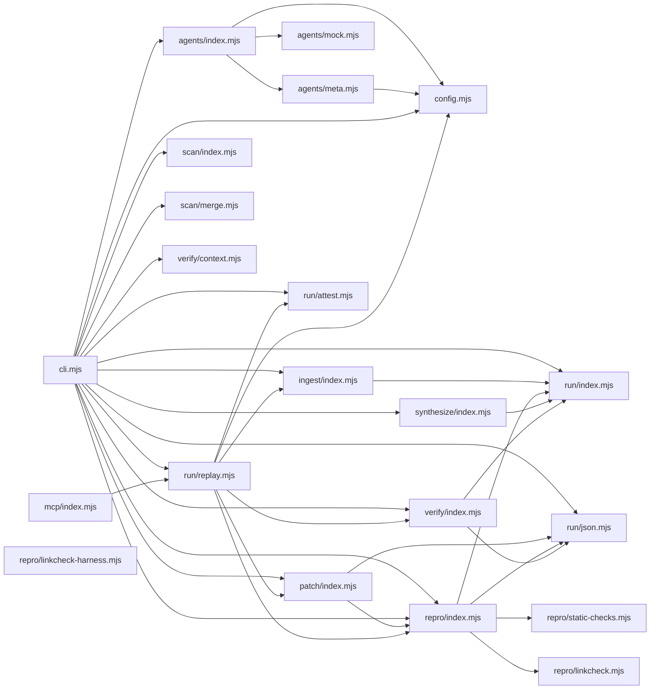

# CodeProof report

Commit: 1e5f577ed8b3a642fb9594385b614309aca017f4  |  run-id: 9ffabbc2a738b498  |  mode: smoke

**Publishing rule:** a finding appears under *Verified findings* only if every citation passed L1 and the adversarial verifier confirmed it. This checks provenance and model agreement, not semantic proof. Refuted, uncertain and moderate findings are in rejected.md.

## Summary

| Metric | Value |
|---|---|
| Files / LOC | 21 / 4221 |
| Import edges / cycles | 36 / 0 |
| Files in scanner prompt | 21 / 21 |
| Findings proposed | 2 |
| Rejected at L1 (bad citation) | 1 |
| Verified | 1 |
| Reproduced by execution (L3) | 1 |
| Moderate confidence | 0 |
| Refuted | 0 |
| Uncertain | 0 |
| Calls / retries | 6 / 0 |
| Tokens in / out | 196740 / 71749 |
| Cached input tokens | 121832 |
| Cost | $1.4074 |

## Verified findings

### F-001 - high - unifiedDiff prefix insertion emits invalid diff with undefined

**Claim:** unifiedDiff does not handle the prefix case where start is -1 but lengths differ: it builds a header with 0 offsets and indexes beforeLines[-1], producing '-undefined' lines.

**Proposed by:** Muse Spark

**Evidence level:** citation-proven + adversarially-confirmed + **execution-proven (generated test fails on the analyzed commit)**

**Execution check:** reproduced by execution: the control passed 3/3 and the trigger failed 3/3 (see Reproduced by execution)

**Citation (from commit, lines 152-159):** patch/index.mjs
```text
  const start = beforeLines.findIndex(function (line, index) { return line !== afterLines[index]; });
  if (start === -1 && beforeLines.length === afterLines.length) return "";
  let beforeEnd = beforeLines.length;
  let afterEnd = afterLines.length;
  while (beforeEnd > start && afterEnd > start && beforeLines[beforeEnd - 1] === afterLines[afterEnd - 1]) { beforeEnd -= 1; afterEnd -= 1; }
  const lines = ["--- a/" + label, "+++ b/" + label, "@@ -" + (start + 1) + "," + Math.max(1, beforeEnd - start) + " +" + (start + 1) + "," + Math.max(1, afterEnd - start) + " @@"];
  for (let index = start; index < beforeEnd; index += 1) lines.push("-" + beforeLines[index]);
  for (let index = start; index < afterEnd; index += 1) lines.push("+" + afterLines[index]);
```

**Verifier (muse-wonder-1.0):** confirm - The code at patch/index.mjs:152-159 returns early only when start===-1 and lengths are equal, otherwise uses start=-1 in the header (start+1=0) and loops from index=-1, so beforeLines[-1]/afterLines[-1] produce '-undefined'/'+undefined' when before is a prefix of after.

## Reproduced by execution

For each finding below, the verifier model wrote two standalone files. They run on a `git archive` snapshot of the analyzed commit inside a permission-model sandbox: no network, no writes, 2 s timeout, three runs each.

- **[CONTROL]** uses a clean, normal input and must pass 3/3. It proves the environment and the way the API is called are valid; if it fails, the finding is reported as `control-failed` and the trigger is never run.
- **[TRIGGER]** uses a different input and must fail 3/3 with an assertion error on the analyzed commit.
- **LinkCheck** (Node 26) runs the trigger under the permission model with inspector coverage and requires that the imported symbol actually executed. Without that linkage proof the finding is not reported as execution-proven.


### F-001 - unifiedDiff prefix insertion emits invalid diff with undefined

**Expected behavior:** unifiedDiff emits a valid diff for a changed line and, for a pure prefix insertion, emits only the added line with no undefined, no deletions of unchanged lines, and no 0 header offsets.

**Control (must pass 3/3 on the analyzed commit):**
```js
import assert from "node:assert/strict";
import { unifiedDiff } from "./patch/index.mjs";
const diff = unifiedDiff("a\nb\nc", "a\nX\nc", { label: "patch" });
assert.equal(diff, "--- a/patch\n+++ b/patch\n@@ -2,1 +2,1 @@\n-b\n+X");
assert.equal(diff.includes("undefined"), false);
```

**Trigger (must fail 3/3 with an assertion error on the analyzed commit):**
```js
import assert from "node:assert/strict";
import { unifiedDiff } from "./patch/index.mjs";
const diff = unifiedDiff("a\nb", "a\nb\nc", { label: "patch" });
assert.equal(diff.includes("undefined"), false);
assert.equal(diff.includes("+c"), true);
assert.equal(diff.includes("\n-a"), false);
assert.equal(diff.includes("\n-b"), false);
assert.equal(diff.includes("@@ -0,"), false);
assert.equal(diff.includes(" +0,"), false);
```

**LinkCheck:** proven - the imported symbol executed under inspector coverage.

**Runner output (last of 3 attempts):**
```text
true !== false

    at file:///tmp/codeproof-repro-YjbSEV/snapshot/.codeproof-repro.test.mjs:4:8
    at ModuleJob.run (node:internal/modules/esm/module_job:569:25)
    at async node:internal/modules/esm/loader:650:26
    at async asyncRunEntryPointWithESMLoader (node:internal/modules/run_main:101:5) {
  generatedMessage: true,
  code: 'ERR_ASSERTION',
  actual: true,
  expected: false,
  operator: 'strictEqual',
  diff: 'simple'
}

Node.js v26.8.2
```

## Architecture

Deterministic facts only: 21 files, 4221 LOC, 36 import edges, 0 cycles. The diagram is generated from the import graph by code, never by the model.



## Limits

- Scan and verify are static: the analyzed code is never executed while the scanner and verifier run. L3 runs only the generated test, on a git-archive snapshot, inside a permission-model sandbox (no network, no writes, 2 s timeout); isolation is process-level, not OS-level.
- No completeness claim; this report shows what passed the gate, not everything that exists in the repository.
- Only direct correctness defects; omission, security and style findings are out of scope for this milestone.
- The L1 gate proves that a citation exists in the commit; the semantic match is judged by the verifier model and presented as such.

